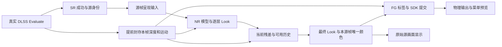

# F6 项目交接

## 0. 当前续接：旧 NR 恢复与兼容（2026-11-15）

优先读 CURRENT-STATE 顶部。用户纠正范围为 ReShade／GIMI兼容，NR细节保留恢复旧逻辑；选项还在但没有预览，以及不选ReShade不能启动均是本轮问题。不要继续历史的算法改进或 Execute／Reset 重写。

- `088aced`：旧NR恢复已提交，11个算法／shader文件与`5d0f0ae`字节相同，history入口与`2052553`相同，保留公共GPU退休容器适配。8项NR定向套件通过，不证明画面已验收。
- `17c8aa2`：嵌套factory捕获实际SDK输出接入预览；物理Release／Resize／Fullscreen与源FG锁、停用和捕获状态分离，queue强引用与成功resize事务闭合。分队列不能认证则不写预览，真实Present继续。真实WARP物理方法25项、factory114项及预览/shared通过。Release x64 exit0／6分25秒，安装已原位覆盖为本候选。
- 无ReShade启动退出已在实际桥`4BC59AD0…`离线复现：公开GetFeatureLevel槽37内部使用私有槽69，公开69槽clone破坏转发；桥单独加载也失败。桥`e061e2d`保留原表只改需要的槽，WARP／NVIDIA各16轮和桥＋F6、NGX ON／OFF各19项通过，未启动游戏。
- 桥`e061e2def63684bc3a303ee8311f8587922c8e6b`已推送用户仓库main，本次fetch确认包含upstream`2db9787`。实际加载位置`temp3/Dx11FsrBridge (2).dll`已原位覆盖，816,640B／SHA256`D1AF6D5D5BE501C6901D34B03B285306629AC259A32219A09B1431045F206799`，原FileId／2硬链接保持。未改用户选项、配置或profiles。

当前F6为 **32,586,240B／SHA256 `881A0D68A5FBFEDF766E9F76B7674BB32BEF784E75729F0B1C40978320919104`**，嵌入`17c8aa2`，mtime UTC `2026-11-14T19:20:39.4509864Z`。`Deploy-F6.ps1 -BuildId local/F6-ASI`回执`DEPLOYED_IN_PLACE`，原FileId`0x000000000000000000020000001b42ff`、6硬链接及6份配置哈希保持，无`.next`。当前F6＋新桥独立真实设备宿主通过，实际游戏加载仍未知；不重复无改动构建／已完成部署。下一新局只能按用户手动测试获得加载、启动、预览及NR画面证据，不能拿旧PID替代。完整Reflex≤60ms、FPS与残影仍未验收，不催测。证据`build/code-followup-20261115/compatibility-restoration/`。搁置的生命周期补丁归档`deferred-submission-lifetime/source.zip`，从未构建部署，不恢复混入；保留原有dirty两文件。当前goal继续active。

## 历史：轮廓稳定与线程归属修复（2026-11-15）

当前部署 **`1f07b0b464be381951cd9fe220507ccbe525f44e`** / `1f07b0b`，DLL **32,599,552 B / SHA256 `D6976017E368FEC38F6021C4EC2CED619202CFF741262E70398BE5AB05C908DD`**，mtime UTC `2026-11-14T17:13:38.9097987Z`。Release exit0 /98秒，UTC17:17已原位覆盖既有local/F6-ASI，原FileId、6硬链接和核对的6份配置/内容哈希保持，无.next；2084项构建输入及946导出名称核对通过。优先读CURRENT-STATE顶部，以下旧身份不能覆盖本条。

本版修短稳定器双线性均值掩盖消失轮廓，同时以当前3×3范围/实际footprint最强tap保留正确重投影的corner和point；不改ABI、绑定或退休。Reflex marker共享skip改TLS+RAII，限帧timer归调用线程并退出关闭；ViT原样launch不复制/分配输出数组。生产HLSL正向4197、28生命周期及3实卡DXIL场景通过；cross-only负控准确检出96项有效细节误拒绝。定向Reflex/FG pacing/源调度、31转发、6712 ViT、48并发timer通过，shared未全量重跑。实卡平坦阶段当前/旧/当前GPU P50 2.475008/2.432512/2.478080ms，增加约0.044ms；不是游戏FPS或完整Reflex。

**用户已答“稍后再测，先继续代码工作”。** 不重复隐藏FG宿主、不再催测；当前新局加载、细节画面、ReShade执行与完整Reflex≤60ms未验收，旧约101–113ms保持未达标。游戏启动/操作/退出仍仅用户完成，不改选项、profile、ASI或构建选择。当前goal继续active，不能因这次拒绝立即手测而设blocked或完成。

下一代码项详见[F6-SUBMISSION-LIFETIME.md](F6-SUBMISSION-LIFETIME.md)：公共NR提交post错认Reset后的代次，以及CurrentOutput、Late capture、OrderedHistory、coverage、SceneCut等独立消费者的同一窗口，必须整体闭合。KernelProfile的90次evaluation完成假设仍未修，尚未添加局部fence胶水。不要只换factory queue，也不要先跨队列移动SR而漏掉BeforeSR、guides、source资源及共享cache所有权。审计发现不代表已确定旧局110ms根因。

本轮证据`build/code-followup-20261115/`，身份与测试清单见CURRENT-STATE。保留`tools/runtime/Invoke-ExactGameEntry.ps1`及`pelican_bicycle.html`既有dirty；本轮所有只读Sol high均已关闭。本版产品代码已保存，不重复无改动的构建、已通过测试或部署。

## 历史：BeforeNR授权部署

## 0. 当前续接（2026-11-14T12:53Z）

当前部署产品 **`f4e65ad58ec3d09becbc8b0935fe4d1747ab7d67`** / `f4e65ad`，DLL **32,584,704 B / SHA256 `B0B5C60B44DF9BCC8DA74A32A9EFE8371B132DCF7D7EC5CFBC1C0701BD50AE15`**，mtime UTC `2026-11-14T12:50:26.7831915Z`；Release exit0 /67秒。12:52Z原位覆盖既有`local/F6-ASI`，原FileId和6硬链接、核对的6配置/内容哈希保持，无`.next`。保留此前细节稳定/深度复用/SDR单写与54b422f的owning SDK输入观察；详情优先读CURRENT-STATE顶部。

BeforeNR颜色纹理已经接通；本次修复同源transfer授权。`runtime/SwapchainColorSpace.h`只认实际本链成功/精确长度的G22/P709声明，wrapper成功forward后写到实际DX11源。BridgeScope在本次原buffer/child/epoch/thread/copy receipt匹配后读源声明，移除格式推断sdr入参。Native DX11/DX12用filterSdrAllowed独立于NR算法colorSpace；Vulkan映射和默认拒绝不变。未知/HDR跳过滤镜仍继续NR，不改用户选项，不新增外桥ABI。

**没有拆分生产/呈现queue，没有生产Wait或退休权限。** 下一步需先从用户新局查看 `F6 SDK input Present observation` 是否实际返回可用fence和目标，再完成实际buffer颜色writer、SDK reader、星铁UntilPresent纹理及多queue退休。SDK数字地址不能变回引用；copy槽不是SDK index；原神ValidNow早期shared Signal→DX11 Wait已经闭合，不要追加整帧SDK等待。完成样本只短暂持有本调用，不存在新的跨帧资源释放路线。

固定真实核心/WARP颜色467264（桥与原生DX12像素）、深度98517、不确定提交24688及颜色事务/效果需求回归通过；测试局部全局TutorialProgress=0曾污染自然Present像素，现初始化测试配置为4，保留失败日志和严格断言。两位新建只读Sol high已关闭，最终复核无具体阻断。证据在总目录`before-nr-transfer/`，上一轮SDK1471/90调用和5负控仍在`owning-input-fence/`；不重复已通过构建部署。shared未全量跑，未执行native Acquire/真实SDK DLL/游戏/Vulkan GPU。

当前原神日志仍停在UTC08:06:43/60,804,125 B，**本候选实际加载、细节稳定及完整Reflex≤60ms仍待用户新局；约110ms保持未达标。** 下一局核`f4e65ad`而非先前异步问题中的旧标记。当前用户仍选BeforeSR，其低分辨率桥输入的未知transfer不能借最终画面声明授权；本版BeforeNR游戏执行也未验证。AI不操作游戏或改选项，不把授权修复当性能改善。桥推送已完成，无需重复。保留Invoke-ExactGameEntry.ps1及pelican_bicycle.html既有dirty。

### 后续诊断：真实 SDK 宿主（2026-11-14T13:25Z）

工具保存点 `d043e65`；产品仍是f4e65ad，未重建部署。`OptiScaler/framegen/dlssg/tests/input-completion-sdk/run.ps1` 已跑真实硬件/真实SDK自动代理链、自有全套输入与Reflex/PCL，24次S_OK Present后取得同设备QI fence但target均0；SDK明确停用FG因窗口未聚焦，exit4/NO_CONSUMED_INPUT_PROOF。实际GetState加载NVIDIA缓存override，SHA与本机bundled sl.dlss_g.dll一致。六安装SDK哈希不变，三项实际清理返回0；错误drain/SDK清理不能吞成成功，exit5终止独立宿主。完整证据在总目录`real-sdk-input/`，勿重复隐藏模式或当成生产队列拆分证明。

可选`-Visible`需用户手动启动并聚焦，宿主不抢焦点、不合成输入；本轮未运行。用户异步选择手动原神新局或独立窗口尚待回应；活动游戏日志仍旧UTC08:06:43。两只读Sol high已关闭。当前阻点是缺活跃FG消费回执与用户新局画面/Reflex采样；60ms保持未达标，不能用这套独立宿主替代。产品排队双向依赖与多queue退休尚未完成。

### 历史：共享SDR部署（2026-11-14T11:00Z）

当前产品保存点 **`0e599810c053801451d323b047ed91a2d1b57b2e`**，嵌入标记 `0e59981`，包含原有细节稳定、深度复用和 SDK 观察修复。Release x64 exit0，72秒；DLL **32,572,416 B / SHA256 `9504586CDD1657DE018678AE00F437DAA2BF35F2CD4F7E210074CCAD649337EA`**，mtime UTC `2026-11-14T10:59:01.6915523Z`。10:59Z 原位部署 `local/F6-ASI`，原 FileId、6 条硬链接及核对的 6 配置哈希保持，无 `.next`；别名含三游戏 cache。

SDR passthrough 仅在 UAV 目标与实际存储格式匹配时共用只读编码原图，删除第二份相同全图写入；HDR / 格式不同 / 非 UAV 仍双输出。上传副本用 mode15，调用方历史编码 contract 仍 mode0，未使用 keep 绑定 typed null UAV。793 个 HLSL/WARP 检查、8 路由/16 分支/4 同资源恢复、28 生命周期、Look80和输出1596检查通过；DXIL/SPIR-V/嵌入头已同步，完整shared与Vulkan实卡未测。只读Sol high复核无具体阻断并已关闭。

实卡完整生产DXIL / 2144×1344 FP16 / 合成平坦输入，单写→旧双写→单写各80样本，GPU P50 **0.098816 / 0.111104 / 0.099328 ms**，本夹具减少约0.012ms；逐位像素、debug errors=0，未启用GBV。证据为总目录下 `shared-encode/`，详见 CURRENT-STATE 顶部。**它不代表游戏整体延迟改善，60ms目标没有缩小。** 活动日志仍是UTC08:06:43旧局，当前加载、细节稳定与整体Reflex≤60ms未验收；约110ms仍超标。下一局核对 `0e59981`。仅用户操作游戏，AI构建/原位部署/读日志。不要重复已经通过的本轮微基准与部署；继续处理实际queue和SDK输入完成依赖。

### 历史：SDK 观察部署（2026-11-14T10:13Z）

队列拆分的下一步实现计划另见总目录 `completion-observation/queue-separation-plan.md`；包含已核对的 source/Present/teardown 接线点与失败语义，尚无行为改动。owning SDK fence capture 必须在 FG hook 原始 Present 返回后、后续 teardown 之前；外层 swapchain Present 返回已太晚。当前主会话新建的只读 Sol high 设计审计 Euclid 已完成并关闭。

当前产品保存点 **`8390a8735ca6880c3626fdc5c77f897ec600167d`**，嵌入标记`8390a87`，保留下面的细节稳定与深度复用修复。Release x64 exit0，62秒，DLL **32,570,368 B / SHA256 `07B80733D1741A5F35400CB641479AE942397810918697A2819CAED7CABCE900`**，mtime UTC `2026-11-14T10:11:57.8610540Z`。10:12Z已原位部署既有`local/F6-ASI`，FileId与6条硬链接保持，核对的6份配置哈希未变，无`.next`，别名包括原神和崩铁cache。

新增`F6 SDK input completion observation`：只记录现有GetState的原始数值，保留请求/返回ABI、实际查询线程/序号/时段和当时provider身份；不添加SDK查询、COM/fence调用或等待，不改变退休条件。已知v3/v4双边ABI门和异常LastError修复经生产函数抽取夹具1243检查/40次SDK脚本调用、旧ABI guard-page与异常两项负控验证；源调度1065、真实延迟适配780检查及guide wiring通过。完整shared未重跑，没有SDK DLL/游戏验收。

**查询位于Dispatch而非本次SDK Present之后。** Present/buffer映射、SDK是否写入字段和GPU完成保持未知；数字地址不是可消费回执。完整队列拆分尚未实施，必须按实际fake buffer identity及swapchain代次闭合producer/最终颜色writer/SDK reader双向依赖。不能借copy槽、自有copy fence或物理输出tail替代SDK要求的present线程input completion。

日志仍停在UTC08:06:43、60,804,125 B；**实际加载、细节稳定和整体Reflex≤60ms均待用户新局**，约110ms仍超标。不要重复已完成的微基准、构建和部署。用户手动启动/进入/操作/退出，AI只构建、原位部署、读日志。ABI审计子智能体Rawls已完成并关闭。

证据目录为总目录下`completion-observation/`，详见`CURRENT-STATE.md`顶部；上一版逐位等价和GPU阶段结果仍有效，但不能算本版游戏验收。

### 17:21（UTC+08）的细节深度复用记录

当前产品源码保存点 **`c5901203eff7f466964029c607536f0f1f5118b5`**，嵌入标记 `c590120`。下述稳定修复已包含，并复用 `DhEvaluateDetail()` 的当前规范深度，删除短稳定器第二次 t5 读取。候选对前版 927 dispatch、u0…u4 共 8,464,384 原始 GPU 存储字节逐位一致，3861 检查零失败；u4-only 负控准确拒绝。28 生命周期与 3 实卡生产 DXIL / FP16 用例重跑通过，Vulkan 字节码重生成不变，独立 Sol high 复核无阻断。共享回归未全量重跑。

Release x64 exit 0，50 秒，DLL **32,566,784 B / SHA256 `B780EB543B4EE2B43A1497B76D3B215A62025DEF8808D3509CCC5146609A36EC`**，mtime UTC `2026-11-14T09:19:29.6803385Z`。17:21 原位覆盖既有 `local/F6-ASI`；原 FileId 和 6 条硬链接保持，包含原神及崩铁 cache 别名，核对配置哈希不变，无 `.next`。此部署身份覆盖后面的 16:58 记录；没有创建包或修改启动器选择。

同条件合成阶段候选 / 旧 / 候选的 GPU P50 **2.741760 / 2.777600 / 2.741248 ms**，各80样本，收益约0.036 ms；不代表游戏 FPS 或总 Reflex。模型链只读审计未发现重复调用，旧日志单有效层 10,800 dispatch / 10,800 modelCalls；尚未实施的 SDR encode 重复全图保存优化仅涉及 P50 0.209 ms 的整个 encode 区间。旧局约 101–113 ms 的整体差距仍需真实 GPU 工作及排队定位。

证据在原总目录的 `depth-reuse/`：`validation.json`、`bitwise-warp.log`、`comparator-negative/result.log`、`runtime.log`、`benchmark/identity.json`、`build.json`、`deployment.json`、`installed-identity.json`、`protected-{before,after}.json`。最新活动日志仍为 UTC08:06:43、60,804,125 B，**没有本候选新局加载、画面或整体 ≤60 ms 验收**。下一局确认加载 `c590120`；仅用户操作游戏，AI 构建 / 原位部署 / 读日志。两位本轮审计智能体均已完成并关闭，不复用。

后续工具更新：`Get-F6RunEvidence.ps1 -Latency` 新增总 Reflex 默认60 ms阈值、有效 GPU active、按线程 / swapchain 的 source pacing QPC统计。22项合成检查通过，独立复核无阻断；旧全日志1299份唯一报告中83份≤60 ms、1216份超标，仍不是固定场景候选验收。旧32条pacing缺字段，不推测各等待耗时。报告为 `depth-reuse/old-pid225400-evidence.json`，解析回归为 `latency-parser.log`。诊断文档同步纠正旧“坏运动可退回屏幕位置”的错误描述，并补齐独立相邻颜色纹理；没有改变用户选项或已部署DLL。

后续队列审计：当前 `DxgiFactory_Hooks.cpp:947/977`、`IFeature_Dx11wDx12.cpp:1200` 和 `DLSSG_Dx12.cpp:1289` 确认共用 WithDx12 queue 与 `eBlockPresentingClientQueue`。下一候选是完整分离 SR / interop 生产与 presenting 所有权，尚未实施，收益未证。SDK 的 no-client-blocking 仅支持 Vulkan，不能在 D3D 直接切枚举。已有 shared writer 返回 Signal / DX11 Wait 早于本帧 NR / FG，不能删；仍须闭合双向依赖、UntilPresent / SDK backbuffer 和各真实 queue/fence 退休。四位本轮只读智能体均已完成并关闭，统一复核记录 `depth-reuse/read-only-reviews.md`。

### 16:58 的稳定修复与旧局定位记录

先读 [CURRENT-STATE](CURRENT-STATE.md) 顶部。本节覆盖后续所有历史操作条件和旧部署身份。

- 产品源码保存点 **`7c2f11ed7503b8aaf117729541c32fc3a36e45a8`**，产品树 `D:/CODE/DLSS5_NEXT-workers/f6-rewrite`，分支 `codex/f6-rewrite`。Release x64 exit 0，50 秒；DLL **32,567,808 B / SHA256 `3B9EDFBE5D222BB4FC18BD79C85EF8308E573C9C542EAA11D3676FF772EC8F20`**，嵌入构建标记 `7c2f11e`，mtime UTC `2026-11-14T08:56:45.0743464Z`。16:56 原位部署至既有 `local/F6-ASI`，原 FileId `0x000000000000000000020000001b42ff`、6 硬链接和核对的配置哈希保持；没有切包或切启动器选项。文档提交不改变该 DLL 身份。
- **最新优先级：先修细节稳定，再核对整体 Reflex ≤60 ms 和性能。目标尚未完成。** 用户本次重新提供的 AGENTS.md 要求游戏启动、进入场景、操作、调整和退出由用户手动完成；AI 构建、原位覆盖、读日志和分析。本次续接未操作游戏，不沿用后文历史 CLI 授权覆盖最新指示。
- 稳定修复将短窗口的相邻原始 RGB 与长历史出生 RGB 分离为 `stabilityContext[2]`；仍用现有当前高精度深度，保留真实 queue/fence、成功 Reset、source 邻接和预算。DX12 8 SRV / 5 UAV，生产 CSO / 嵌入头已逐字节核对；重新生成 Vulkan 字节码不变，保留后端编译，未做 Vulkan GPU 验收。
- HLSL/WARP 3861 检查及滚动出生 / 错用长出生外观两项负控通过。28 个生命周期 + 3 个真实 NVIDIA / 生产 DXIL / FP16 用例共 2678 检查通过；新光照序列 48 源帧稳定，旧外观负控在源 8 失败。原测试若不断刷新出生信息，会漏检，不能再拿它作为稳定证明。公共颜色 / 输出 / Look、Reflex、pacing 定向回归通过；shared 未全量重跑。离线检查不执行完整游戏模型，**本候选实际加载和游戏画面仍待验收**。
- 同宿主、同资源、2144×1344 / guides1536×960、平坦合成输入的当前 / 旧 / 当前 GPU 阶段 P50 **2.780160 / 2.698240 / 2.779648 ms**，增加约 0.082 ms。三组各 80 样本，包含正常到期分支，debug errors=0，GPU-based validation 关闭，exe / CSO SHA 前后绑定。旧的 `stability-benchmark-*.log` clear 描述符 API 误用，已作废；有效数据在 `stability-final-benchmark/`。不能据阶段对照宣称游戏没有降帧或整体 ≤60 ms。
- 已有有效新局是上一版 PID225400 / creation FILETIME134391152493078336，启动 UTC07:34:09，实际加载 `b0eb017` / 磁盘 A9DDE228；已进入大世界，不能继续说启动器无法启动。两段前台显示变化率 88.66 / 86.47 Hz，源 Evaluate 约 14 Hz；总 Reflex P50 **101.489 / 113.347 ms**，GPU 活跃 P50 **65.043 / 66.662 ms**，60 ms 未过。总值按同报告端点跨度，不重复叠加队列、GPU或模拟，也不等于完整输入到显示。`before-ab.log` 是 `final.log` 前缀，不能重复统计。旧版 PID220956 首次对照失焦，11.09 Hz 无效；没有有效游戏新旧 A/B。当前安装已是本节新候选，不能拿旧 PID 当本候选加载证据。
- 本局没有重复 Sleep 的确定证据。现已用每线程 5 秒的持续 `F6 source pacing` 记录原 token、实际 SDK Present / 收尾 / 解锁 / leased Sleep / limiter 的成对 QPC 和返回值，保留所有等待行为。`present_tail_ms` 是 SDK 返回后的包含性尾段，不能与子项再次相加；没有同份 Reflex report 的自动 join。native phase 现在分开输出 legacy decision 和 feedback plan，避免把旧字段 false 当成独立反馈断链。
- 下一局由用户在原场景手测稳定跳变 / 残影，AI 读取新局日志绑定 PID、creation time、加载 `7c2f11e` 和当前磁盘身份，再核对总 Reflex、GPU 工作与排队、显示采样。潜在等价优化是复用 `result.context.a` 的已验证当前深度，尚未实施；若实施，需对 u0…u4 跨帧逐位验证，不能仅凭静态审计宣称收益。保留 SR / NR / FG 及用户参数，不扩录制池、不复用旧帧、不删除拒绝条件。
- ReShade 当前设置仍是 BeforeSR，缓存自然 runtime 已命中，但前置滤镜仍被未知颜色域拒绝、没有实际执行。BeforeNR 私有颜色读取缺口仍待修，不能靠格式或 IsHDR=0 自动授权 SDR。桥历史推送回执：14:57 `thx114/genshin_fsr_brigde:main`=`a03e99dc182430a605791f76487bc94acb5e21a8`，当次上游=`2db978753eb82ae8e4f90b8a0a13023db832b721`，ON/OFF 各18/18；未部署新桥，未再次认证远端最新。本轮 F6 未推送。

证据总目录 `build/genshin-reshade-20261114/detail-feedback-20261114-140355/`。当前身份见 `stability-source-bound-build.json`、`stability-deployment.json`、`stability-installed-identity.json`；验证见 `stability-validation.json` 及对应固定日志；有效成本 / 延迟见 `stability-final-benchmark/identity.json`、`stability-latency-observations.json` 和 `analyze_stability_round.py`。保留 `Invoke-ExactGameEntry.ps1` 既有未提交改动与无关 `pelican_bicycle.html`，不 reset / clean。所有本次只读 Sol high 子智能体已关闭；新任务由当前主会话另建，不复用过期实例。

## 0.1 历史：不开预览的早归还／原子查询版（2026-11-13）

### 切换会话停止点

用户最新要求：“请编写交接，我更改会话和模型了。”性能开发在此停止；本次仅更新交接和状态入口，没有继续改产品代码、构建、部署或提交／推送。

唯一产品写树 `D:/CODE/DLSS5_NEXT-workers/f6-rewrite`，分支 `codex/f6-rewrite`，HEAD `6cf94c0979a2697775992f4ffa8005f57c8817eb`，保留累计未提交改动。已配置 `origin` 为 `https://github.com/thx114/DLSS5-F6-NEXT.git`；下文历史“没有 remote”不再适用。导航根 `D:/CODE/DLSS5_NEXT` 只同步入口，不在其中构建 F6 产品。

**新会话先读产品树 `AGENTS.md`、`README.md`、`docs/CURRENT-STATE.md` 和本第0节。第0.05节及后续涉及旧部署、进展和授权的内容仅作历史；其中自主操作游戏的授权已撤销，不得继承。当前游戏测试完全由用户手动完成。** 不调用旧会话子智能体；需要分工时由新主会话新建，检索／复核按当前规则使用 `gpt-6.1-sol`／`high`，不使用 DS。

恢复顺序：

1. 以 `build/fg-runtime-followup-20261113/early-guides-result.json` 为最新构建／部署回执；最终版 `AB0B37E0…` 已部署，但加载身份、显示帧间隔和游戏性能均未验收。无需仅为续接重复构建或部署。
2. 先接收用户手动重开崩铁、关闭所有输入预览后的战斗反馈，再读取同局新日志，核对 PID、时间与加载证据。旧26B／A6局只作定位背景，不能当作AB0新版验收；现有手测日志时间按UTC+8记录，不再加八小时，构建mtime明确标为UTC。
3. 若仍卡，沿正常渲染路径继续区分 SR 新输入空档、复制槽真实退休等待、SDK Present／Reflex等待，以及GPU工作区间内的CPU阻断；CPU阻断仍需同帧证据，不能由Reflex区间减活跃时间直接推定。优先减少无用CPU调用并利用已有GPU异步提交，保留真实queue／fence依赖。绝区零预览改造、HDR与内置SR缓存均不恢复。

本轮关键代码入口（均相对产品树）：

| 文件 | 接续关注点 |
|---|---|
| `OptiScaler/inputs/FG/Upscaler_Inputs_Dx11wDx12.cpp` | `SetUpscalerGuidePair` 后的StarRail早Seal，以及诊断需求保留原recording的分支 |
| `OptiScaler/framegen/dlssg/DLSSG_Dx12.cpp` | guide提交／归还、Present颜色就绪与FG采样门 |
| `OptiScaler/runtime/GuideCapture.cpp` | `OfflineWanted` 无请求快路径及Capture模式查询 |
| `OptiScaler/runtime/GuideCapture.h` | 原子 `GetPreviewMode` 与recording需求接口 |
| `OptiScaler/runtime/GuidePreview.inl` | 原子模式读取、`NeedsOpenFgGuideRecording` |

所有本轮证据、暂缓补丁和两份源码保存点继续放在既有 `build/fg-runtime-followup-20261113/`，不要另起一套轮次目录或删除 `build/`。源码回退边界见下文；NR已在更早的SR接缝复制guides到自有slot，后续NR不重读已归还的raw guides，这是最终复核确认的安全前提。

### 已部署改动、验证与旧局证据

用户最新纠正：**不是仅在开启预览时卡顿，主线必须是不开预览的正常渲染**。绝区零native guide预览改造暂停，已另存 `build/fg-runtime-followup-20261113/native-preview-deferred.patch` 并恢复到改造前原字节。撤出时五个生产文件与 `source-before-native-preview.zip` 完全一致，后续仅追加下述原子查询修复；不能把新预览方案说成已实现或已部署。

本轮新增：StarRail正常路径在SetUpscalerGuidePair后早Seal，把共享guides归还从Present颜色复制／NR之后提前到真实SDK快照提交之后；仍以同一实际queue的Signal和DX11 GPU Wait保护下一次写入。FG guide／offline需求保留原recording；颜色预览先colourReady再预约。OfflineWanted无请求直接false，NeedsOpenFgGuideRecording使用原子mode，不以preview try_lock失败当没有需求。没有新CPU完成等待，没有扩池、队列拆分或Reflex策略更改。

最终版已部署：SHA256 `AB0B37E017C59F54608A67A8C5AA6BB2E360FAF55088A7727FFDF20A31457F2F`，33,899,520 B，mtime UTC `2026-11-13T11:26:47.5877949Z`；Release x64 exit0，90秒，`early-guides-atomic-build.log`。中间候选B84被独立复核发现正常Present会求值带mutex的GetPreviewDemand，未部署；最终新增原子GetPreviewMode，替换Present/Capture两处查询，精确revision校验保留。持锁跨线程用例和独立增量复核通过，无剩余源码阻断结论。WARP／源码复核不证明实际GPU排队改善。

最终DLL已分别原位覆盖既有 `local/F6-StarRail-GapPacing`（原FileId `0x000000000000000000070000001df2d3`，2硬链接）及 `local/F6-ASI`（原FileId `0x000000000000000000020000001b42ff`，6硬链接）。崩铁当前GapPacing runtime、原神与ZZZ当前F6-ASI runtime均为同一最终字节，FileId和全部硬链接集合未变。部署回执 `early-guides-deployment.json`，核验 `early-guides-installed-before.json`／`early-guides-installed-after.json`，综合 `early-guides-result.json`。安装根仍为 `D:/APPS/test/TEST/HoYoShadeHub_Portable_1.4.5.0_x64_Full`。没有新建包／runtime，没有改启动器选择、INI、profiles或ASI，无需切换选择。尚无本候选新局加载、显示间隔或手动性能验收；需用户重开游戏，先关闭预览复测。

验证：`early-guides-final-tests.log`中FgHandoff WARP 30场景／1186检查，包含下一DX11 writer越过被阻塞的后续Present工作、仍等待真实guide reader的像素证据；三个负控均被检测。GuideCaptureWarp、GuidePreviewWarp、producer replay检查通过；43项真实StarRail准入和10项采样门静态检查及GuideFgWiring连接通过。不是SDK／游戏／FPS验收，尚无本候选手动测试或显示间隔证据。

手动旧局证据：崩铁PID188816，26B磁盘身份，`manual-test-188816.log/json`；用户反馈有所改善但仍卡。18:25:03.400988～18:26:41.688237持续周期前台观测段，2063源间隔P50 44.730ms、P95 57.869ms、max595.247ms，174份唯一有效Reflex GPU启动前等待P50 48.460ms、P95 56.179ms。前台复制槽CPU等待样本max40.555ms；不能删其真实reader退休条件。

原神PID209436，A6磁盘身份，用户基本流畅但有GPU排队／延迟。快照 `manual-genshin-209436.log`，SHA256 `D7C036C74755BEB480C7D87610B97A2510168437C271B12F2A40C0B84DF67777`，43,504,357B；周期前台观测873份有效唯一Reflex GPU启动前等待P50 17.663ms、P95 51.019ms、max78.118ms；复制槽CPU等待样本max50.029ms。三条error为首帧Exposure缺失及18:34:00.065274、18:34:54.611557两次Off+retain result38，不说零错误。完整统计 `comparison-genshin.json`、`comparison-starrail.json`、`manual-genshin-evidence.json`；两游戏统计窗口／构建不同，不作相同条件对比。

ASI日志已快照为 `manual-cache.log`。例如18:25:27.067～27.613、18:25:33.530～34.047、18:26:12.213～12.705的parked/reused覆盖新Evaluate入口空档，Present继续；只证明逻辑feature生命周期间隔，不能证明ASI吞Evaluate。入口后的缓存／早退不能解释无新入口；srOutsideUnknown包含Present，不能叫项目外耗时。Reflex区间减活跃时间也未跨时钟关联，不证明CPU阻断GPU。所有这些旧局均无新显示间隔或加载内存SHA。

ZZZ最新日志实际在 `OptiScaler/local/F6-ASI/logs/nap_cn/OptiScaler.log`，PID201984，18:45:54～18:54:35，SHA256 `943C22E4343851937BF446BD929847A9E220B178F31632BE6031CFB535CAD8EE`，28,878,638B。F6-ZZZ-ASI根日志是11月12日旧局。A6局有真实producer queue/fence、sr_succeeded和depth/MV tags accepted，尚不证明最终FG。CaptureAcceptedGuides要求原独立UI列表，native游戏SR列表不满足，属于确定源码阻断；本局仅记录Preview off，没有直接拒绝状态证据。未来再改需在仍有效的原producer录GPU copy，不能Present重读已归还的ValidNow资源；此线目前暂停。

代码回退：`source-before-early-guides.zip`（本轮最初六文件，SHA256 `6515848A3C3FA340190308E3883DCCD239337E1DE33C7BF03F45C064FFAA0580`）；`source-before-native-preview.zip`（后续runtime/helper已改状态，SHA256 `7925B88142D810B39B65DA887667240F87B4849793F906B319B1D8B92C22B314`）。后者是原子查询修复前的中间候选字节，不是本轮全量修改之前的回退；不能git checkout覆盖累计改动。未提交、未推送。

后续先手动重开游戏复测关闭预览时的战斗卡顿和GPU排队，再按实际日志决定是否继续拆解copy／SDK等待；不把WARP、构建、部署等于实机修复。用户全手动启动、进入场景、操作、设置和退出；AI仅构建、原位覆盖和读证据，不操作桌面或CLI启停游戏。HDR暂缓，SR缓存由用户NgxFeatureCache.asi提供，不恢复内置池。无depth/motion的菜单FG未实现；9项已知问题、7项TODO保留。

## 0.05 上一阶段停止交接：FG-only 配置失效与自主测试（历史）

**以下记录上一阶段停止时状态，已由第0节的续接要求与新部署覆盖。** 当时用户要求：“请填写交接，停止目前的工作。”该阶段未提交、未推送；保留全部既有及本轮未提交修改，不得 reset/clean。

当前唯一产品树 `D:/CODE/DLSS5_NEXT-workers/f6-rewrite`，分支 `codex/f6-rewrite`，HEAD `6cf94c0979a2697775992f4ffa8005f57c8817eb`。以下为停止时状态，下方历史候选和“当前”描述不覆盖本节。

### 授权与保留边界

**历史授权，现已撤销，不得作为新会话操作许可。** 当时用户曾允许 CLI 启动、操作游戏窗口、进入测试场景、采样与正常退出自己启动的会话；随后用户要求“改成我手动测试”，当前 AGENTS.md 和第0节已取代该授权。以下构建／测试记录仍保留为历史。构建选择、功能开关、INI、profiles、ASI 由用户设置；部署仅原位覆盖既有 DLL、保留硬链接，占用则 `.next`，不强杀游戏。

不恢复内置 `PersistentSrDx11` / `PersistentSrPool`，SR 对象缓存继续交给用户自备 `NgxFeatureCache.asi`。原神/绝区零部署未改；9 项已知问题和 7 项 TODO 保留。

### 必须区分的 DLL 身份

| 状态 | SHA256 | 证据与边界 |
|---|---|---|
| 当前实际部署的中间版 | `FECDB5AD0954028F3791DFEFD79633E4DD73C26380ACFC7B13CF72FB3953F5F5` | `deployment.json`；已运行 PID210324；不含最终 RAII 异常修复 |
| 最新已构建的最终版 | `26B48417F6C2C2EDD8FE6537FC7FCFD84B65F421F02F681FF6E077C76C57A962` | `build/out/OptiScaler.dll`；包含 RAII 修复和计数字段更名；未部署、未实机测试 |
| 本轮之前部署的版本 | `2E3CAF8DA5E76179D91B9281B5ECED582D5EA5DCF81C53FAD8D2AD2C9B6A9AEF` | 用户 PID44888、自主基线 PID189788 的当局磁盘身份 |

停止交接时重新读取构建产物、包目录及 runtime 三处的 SHA256，与上表的当前部署和最新构建一致。安装根为 `D:/APPS/test/TEST/HoYoShadeHub_Portable_1.4.5.0_x64_Full`，当前包 `OptiScaler/local/F6-StarRail-GapPacing/OptiScaler.dll` 与 runtime `cache/games/hkrpg_bilibili/OptiRuntime/0BEE3ECB82F4166C/OptiScaler.dll` 均为 FECDB5AD；FileId `0x000000000000000000070000001df2d3`、原两个硬链接保持。部署回执的 Artifact 指向可被后续构建覆盖的路径，必须使用回执内的 SHA 区分部署版与最新产物。

最新构建 Release x64 exit 0，33,898,496 B，mtime UTC `2026-11-13T09:53:58.5238524Z`；回执 `build/fg-runtime-followup-20261113/build-final-console.log`，既有编译/链接警告仍在。不能把该构建当作已部署或已游戏验证。

### 本轮源码与独立复核

1. `DlssgOptionsPolicy.h` 新增 `ConfigurationState::InvalidateDlssg()`：独立 FG epoch，保留 Reflex epoch；共享 serial 仍取消重入/被取代事务。完整 Scope、600 源帧 keepalive，以及 SDK 失败、异常、未知 payload、真正 Off/生命周期变化时的全失效均保留。新增提交 reason 与 `ReasonName()`。
2. `DLSSG_Dx12.cpp/.h` 新增 FG-only 失效入口；成功 StarRail gap 只失效 FG ACK，恢复时 Reflex force 改为 `resumingInputGap && !starRailFrame`。独立复核发现 P2：gap 直接 SDK 回调抛异常会绕过普通失败清理；最终 `FinishSuppression` RAII 已修复未完整成功时全失效，覆盖 Off/token/tag、普通 false 及 cached-Off 清标签异常。正常成功仍可保留 Reflex ACK。
3. 新增低频配置计数与 `CallerCpuTrace.h` 的 options / FG UI allocator CPU 采样。最终计数字段为 `completed_attempts`、`submit_attempts`、`ack_hits`，注明 `excludes_throwing_calls=true`、`dispatch_only`；不是完整 SDK 真调用总数，也不覆盖 gap Off/teardown 或抛异常调用。真实 queue/fence 等待、资源退休和当前源帧准入未改。

独立报告 `retained-reflex-review.md` 最终确认 P2 已关闭，本轮范围无剩余已知源码阻断；报告中 R2 仍标为计划，主会话随后已在源码更正计数字段。新增“抽取实际 suppression 生产函数”的异常回归在用户要求停止时被中止，当前无完成或通过证据；不能用 9204 项策略测试替代该生产异常路径验证。本轮子智能体均已关闭，不再调用。

本轮修改前源码 `build/fg-runtime-followup-20261113/source-before-runtime-followup.zip`，SHA256 `6C71648C0F729CE01667B72DD2722C406F8FD8FE056394A56E0563814B66E76D`；单独差分 `runtime-followup.diff`（已纠正 CRLF 比较问题，约 299 行）。这是代码保存点，不要求切换包或恢复启动器设置。

### 用户新局与两次自主运行

全部固定证据在 `build/fg-runtime-followup-20261113/`。时间为 2026-11-13 本地时间；加载模块路径与当局磁盘身份有记录，三局 loaded-memory SHA 均未测。

- 用户 PID44888，17:08～17:12，正常退出。完整日志 13,214,936 B，SHA256 `8282F01E325191BF61392C3708AF65B106E9426F11AC96EA5D7AD0CEFA78C539`，session 保存逐字节一致；磁盘为 2E3CAF8D。来源 `provenance.json`、`independent-log-findings.md`、`independent-analysis.json`。sampled 前台 2567 个完整源间隔 P50/P95/最大 42.425/57.987/777.318 ms，21 次 >=100 ms；69.954 秒跨失焦，不当技能卡顿。37 次 gap/fresh 配对（36 次完整前台），fresh→恢复中位 4.956 ms、最大 32.596 ms；短至 43.595 ms 源周期也会触发 Off/On。前台 210 份 Reflex 同报告 GPU 启动前排队 P50/P95/最大 43.190/56.383/94.373 ms。20 条同步 present mutex 警告与切换相邻，仅证明相关，未证明根因。
- 自主基线 PID189788，2E3CAF8D，17:42:47 启动，17:47:59 请求 `CloseMainWindow` 并确认退出；`baseline-exit.json` 的 ExitCode 为 null，不能补称 0。日志 `OptiScaler-189788.log`，19,497,105 B；`baseline-runtime.json` 和 `baseline-launch.json` 绑定创建时间、模块路径和启动。前台 30 秒显示采样 3540 个有效间隔，P50/P95 7.6095/12.8631 ms，约 118.47 Hz，详见 `baseline-focused-display.json/.csv`。首份 `baseline-display` 为失焦采样，整体状态 unknown，不能作为前台性能指标。
- 自主候选 PID210324，FECDB5AD，17:50:06 启动，17:53:36 请求 `CloseMainWindow` 并确认退出；未记录退出码 0。日志 `OptiScaler-210324.log`，13,674,444 B；`candidate-runtime.json`、`candidate-launch.json` 与 `candidate-exit.json` 保存当局身份及退出。49 次 gap 对应 49 次 fresh 恢复；source3610 的 3600 次配置处理中，FG 提交尝试 49、ACK 复用 3551，Reflex 提交尝试 6、ACK 复用 3594（5 次 keepalive），证明正常路径可跨 gap 保留 Reflex ACK。该中间版日志字段 `dispatch_real_calls` 应理解为提交尝试。`candidate-focused-display.json/.csv` 已保存，停止时尚未整理其显示统计。

汇总为 `autonomous-runs.json`。两局自主运行各有一条 error 尚未核对，不能称零错误；窗口工具初始化一直报“系统找不到指定的路径”，重置后仍失败，没有成功截图或视觉观察。CLI 激活步骤报告失败，后续日志有 focused:yes，只能作为焦点日志证据。两局未确认相同场景，不能宣称战斗卡顿或延迟改善；显示频率也不能当有效插值或视觉通过。停止前已确认自己启动的两局退出，未操作其他旧原神进程。

### 已有验证与未闭环项

已有 options CPU 9204、pacing 323、residency 1035、StarRail 真实准入 43、gap pacing 610、options 静态连接 98、preview 静态 8 项通过；本轮相关产品文件 `git -c core.whitespace=cr-at-eol diff --check` 通过。本轮没有重跑全量 shared/WARP。最新 RAII 版已构建，但没有部署或实机测试，也没有新增生产 suppression 异常回归完成/通过证据。

队列拆分仅只读调查，见 `queue-separation-review.md`，没有实施。不能仅更换 present queue 或删除 same-queue 门；必须同时处理 producer queue→FG reader 的真实凭据/Wait、reader→下一 DX11 writer 的独立共享返回 fence、SDK fake backbuffer 与 UntilPresent 输入复用、各真实 queue/fence 的退休及多 signaler 共享 fence 乱序风险。没有证据证明拆分一定解决卡顿。

**继续工作须等待用户重新要求。** 届时优先承接：未部署的最终 RAII 版与部署中间版身份差异、未完成的生产异常回归、两局 error 原文核对、候选显示统计以及有场景证据的卡顿/排队/视觉验收。当前用户反馈仍是“平均帧数提高，卡顿点还在”；不得因构建、ACK 命中或独立复核通过而宣告性能问题解决。`build/` 中的日志、差分和源码保存点为 ignored 资料，跨机器交接须另行保留。

## 0.1 上轮部署：崩铁 FG 配置去重复与队列切换（2026-11-13）

**用户已实测上一轮 D1004802：平均帧数提高，卡顿点仍在。新候选 2E3CAF8D 已原位部署，实际加载、画面及性能尚未验收；FG 排队与卡顿恢复目标仍未闭环。** 不把平均帧数提高等同于卡顿解决。

当前唯一产品树 `D:/CODE/DLSS5_NEXT-workers/f6-rewrite`，分支 `codex/f6-rewrite`，HEAD `6cf94c0` + 未提交改动；不要 reset/clean。部署仅覆盖既有崩铁 DLL，保留包与 runtime 硬链接；占用时同目录 `.next`，不得声称已替换。当时未修改启动器选择/开关、INI、profiles、ASI，也未操作游戏进程/窗口；后续测试权限以第0节为准。

新局证据与本轮回执集中于 `build/fg-stutter-recovery-20261113/`：

- `OptiScaler-185544.log`：本地 07:20～07:26，完整 24,671,677 B，SHA256 `4B262C6BFB9421499A8C1ACA6EA25EEC7E8524F666AB950176E488AE0416F16F`；与 session 保存的 16 MiB 尾段逐字节匹配。磁盘 DLL 当时为 D1004802，loaded-memory SHA 未测，正常退出。本局没有同步显示采样或技能时间标记。
- 一次源 Evaluate 间隔 1738.783 ms 后反复出现长间隔；按连续 8 次间隔不超过 64.086 ms 的离线定义，约 4.409 秒恢复源节奏。59 次断档均找到后续 fresh 恢复，典型 fresh Evaluate→FG 恢复 7.117 ms，最大 54.250 ms。优先调查反复缺源与提交背压，未证明 fresh 已到后 FG 仍卡死数秒。
- 517 份唯一 Reflex 报告的 GPU 启动前排队 P50/P95/最大为 28.586/50.603/82.093 ms；copy allocator CPU 等待最大 66.471 ms，copy Execute 提交最大 155.921 ms。CPU 跨度可能嵌套，提交耗时不等同 GPU 执行耗时；没有已记录 allocator 等待 5 秒的证据。FramerateLimit=auto，不归咎于限帧。
- 分析与来源见 `findings.md`、`analysis.json`、`samples.txt`、`provenance.json`、`run-evidence.json`；`analyze_recovery.py` 已执行，Reflex 数据与现有运行证据解析器交叉核对。

本轮去除 StarRail 专用的 `SubmissionPolicy::EveryDispatch`，使用已有公共 ACK 复用完整 scope/payload 相同且由产品独占的 FG/Reflex 配置；保留未知/共享 SDK 的真实调用、600 源帧 keepalive、失败失效、Off→fresh On/Reflex，以及每帧 tags/constants/Dispatch 和当前 source 的 Accepted 检查。另修复 `_WaitForInteropCopyOnPresentQueue()` 成功退休旧 queue 后未采纳 null owner、导致后续反复 CPU drain 的问题；失败仍保留旧 owner，实际 queue/fence 退休条件不变。未证明 PID185544 曾触发此 null 转换，不能称为该局卡顿根因。

options CPU 8742、pacing lease 323、residency 1035、gap pacing 610、StarRail 真实准入 43、options 静态 94 项通过；interop 33 项连接与 195 项抽取生产代码 CPU 检查通过，旧 null-owner 负控按预期失败。重跑 FG handoff WARP 29 场景/1102 检查及负控、bridge retirement WARP 15/494、NR output WARP 1596、DX11 shared read 121、swapchain policy 207 和 Reflex timing 12 场景；未全量重跑 shared。当前主会话新建的 gpt-6.1-sol/high 复核 options 变更无已知源码阻断，主会话复核 queue 修复。离线验证不能替代游戏性能验收。

Release x64 构建 exit 0，既有警告保留。新 DLL 33,894,400 B，SHA256 `2E3CAF8DA5E76179D91B9281B5ECED582D5EA5DCF81C53FAD8D2AD2C9B6A9AEF`，已在本地 07:55 原位覆盖 `D:/APPS/test/TEST/HoYoShadeHub_Portable_1.4.5.0_x64_Full/OptiScaler/local/F6-StarRail-GapPacing/OptiScaler.dll`。其与 `cache/games/hkrpg_bilibili/OptiRuntime/0BEE3ECB82F4166C/OptiScaler.dll` 保持同一原 FileId 1970324838937299、2 个硬链接，两处哈希一致。两份 INI 与两份用户 ASI 哈希未变；核验并移除仅含旧 D100 字节的过期 `.next`，当前无待替换。源码、构建和部署回执见 `round-result.json`、`deployment.json`、`build-console.log`、`options-tests.log`、`queue-contract-tests.log`。本轮修改前源码保存点 `source-before-options-queue-recovery.zip`，SHA256 `F4D4AF37B83C060CE1B048BCB616ED5EEDC72F222993B090A0F36F559FEEFF96`，只用于代码回退。

此处为07:55部署时的历史边界；17:08的新局PID44888和后续修复以第0节为准。尚未实施队列拆分：SDK 的 `eBlockNoClientQueues` 目前仅支持 Vulkan，D3D 会退回阻塞 presenting queue；现有 shared-guide 依赖同一 source/presenting queue，拆分必须同时证明 producer→reader、reader→下一 DX11 writer 与真实队列退休，不能只切枚举或移除等待。

## 0.2 更早：FG 共享读取与预览退休（2026-11-13）

以下为 D1004802 的实现与当时回执；用户随后确认平均帧数上升但仍卡，当前部署以第 0 节为准。该轮补齐 PID171748 的实际显示采样，证据目录 `build/starrail-skill-stutter-20261113/`：

- `display-battle-20261113.csv`：PID171748，主物理链 `0x000002DFB91E4100` 共 3822 次事件、5 次 dropped。显示间隔 P50 7.187 ms、P95 10.534 ms、P99 28.224 ms、最大 241.687 ms；87 个间隔超过 16.7 ms。CSV 保留原始的 14:17:32.775～14:18:02.682 时间值，其绝对时间存在偏移，不作为本地实际时间。用户确认采样全程明显卡顿，显示事件多不等于有效插值。
- `OptiScaler-171748-display-battle.log`：FILETIME 证明日志前缀已经是本地约 06:17；旧文档按 UTC 再加 8 小时为 14:17 的解释错误，不能把该局排在 07:20 新局之后。相对间隔结论保留：源 Present 中位 43.954 ms；最大显示空档对应约 241 ms 源空档，约 240 ms 在产品 hook 外。两次约 536/467 ms 暂缺 Evaluate 后第一张 fresh 源帧就恢复，无本局乱序或持续不恢复证据。不能凭 CPU burst 判断显示挤帧，不能直接删 Sleep。
- `display-battle-findings.json` 汇总本次事实、边界和原始文件哈希；既有 summary/window 文件保留。
- `guide-pair-171748-622126334.trace.json` 只有事件，没有 `f6.guide-pair.v1` 像素对。trace 比战斗采样晚十多分钟；phaseVerified=false，不当成同步像素证据。源/提交/最终颜色 join 正常不代表 guide 像素没有被覆盖。

该轮代码：

1. 预览三槽原需等待四槽 UI producer 下一轮 Reset 才可发布。新增 `GuideCapture::NeedsReset` advisory，由 DLSSG 在真实 UI owner fence 完成、列表未打开时实际 Reset allocator/list、通知既有 reset 路径并 Close；不等 GPU、不扩池、不预留未提交 fence 目标。正常预览仍最多 30 Hz。
2. 将已有 DX11 shared-guide pin/handback 覆盖崩铁。FG RF 读取晚于 SR 输出交接，Present 在原提交位置 Seal 实际读，并在其 Execute/Signal 后建立 DX12→DX11 反向依赖；下一次 `PrepareUpscalerResources` 写共享 cache 前也 Seal。Lifecycle guard 只串行，不触发 Inputs 的下一帧准入。frame/generation/owner/queue 与核心提交回执必须一致，禁止借诊断 observation 证明交接。
3. 双帧导出失败保留最后捕获原因并写 trace；超时边界已就绪的真实双帧走正常校验/导出。没有像素时仍不伪造像素文件。

最终验证已通过共享交接 WARP 29 场景/1102 检查，旧 queue、延迟 guide 读取与缺少 writer Wait 三项负控均按预期检出；GuideCapture 24019、GuidePreview 1317671、重复 producer Execute 58、MenuPreviewOutput 992 检查通过，包含实际忙队列不能提前 Reset 的条件。610 项源 gap pacing、43 项 StarRail 真实准入及定向静态检查通过；未全量重跑 shared 回归。gpt-6.1-sol/high 最终重新读取磁盘复核，无剩余已知源码阻断；运行性能和像素双帧仍未验收。

该轮 Release x64 构建 exit 0，DLL SHA256 `D1004802E3C91B405E9DD903211FB91D651C7F8792D99AB6BDB4E012A92D95A1`，33,894,912 B，既有编译/链接警告保留。首次覆盖遇到错误 32，用户手动退出崩铁后原位覆盖成功：`D:/APPS/test/TEST/HoYoShadeHub_Portable_1.4.5.0_x64_Full/OptiScaler/local/F6-StarRail-GapPacing/OptiScaler.dll` 与 `cache/games/hkrpg_bilibili/OptiRuntime/0BEE3ECB82F4166C/OptiScaler.dll` 为同一原 FileId 1970324838937299，nlink=2；当时两处 SHA 与候选相同。两份 INI 和两份 ASI 哈希未变。原暂存 `.next` 当时与安装字节相同；当前安装及待替换状态见第 0 节。

精确测试、源码与部署回执为上述证据目录的 `guide-handoff-result.json`、`guide-handoff-deployment.json`，构建输出另存 `guide-handoff-build-console.log`，捕获/预览输出为 `guide-preview-tests.log`。本次 13 项修改源码/测试指纹构建前后及部署后匹配，不是全部依赖指纹。

该轮源码保存点 `source-before-guide-preview-retirement.zip` 在同一证据目录，包含修改前字节，SHA256 `D3BC243E1836F56818D087991C80C3D5A3AEF07AAE219FAEBDA45D64C9212FCA`；只用于代码回退。更早 `source-before-marker-gap-fix.zip` 及 AFA9 回执保留原身份。旧切包/启动器恢复脚本不是当前部署入口。

插件仍在用户自备目录 `D:/DL/F6-StarRail-plugins-20261113`，MFG 与 NgxFeatureCache 均已有本局工作证据；后者与用户 ZIP 一致，不再归因于没放插件。不恢复内置 SR 对象池。原神/绝区零部署未改，HDR 暂缓，无 depth/motion 菜单 FG 未实现；9 项已知问题与 7 项 TODO 保留。

以下为历史，不覆盖第 0 节。

## 1. 7D 候选阶段：2026-11-12 历史状态

以下为 7D 候选阶段记录；其后源码状态和当前验收边界以第 0 节为准。**普通 FG Release x64 候选 7D042E99 已构建并通过当时的定向回归；未部署、未实机验证。** 下方历史私有候选和部署记录保留原身份。

### 目标与身份

该阶段目标为修复排队、绝区零已开 DLSS 却提示未接入、星铁只有 NR 没有 FG；当前范围以第 0 节和根 AGENTS.md 为准。

| 对象 | 本次事实 |
|---|---|
| 唯一产品写树 | D:/CODE/DLSS5_NEXT-workers/f6-rewrite，codex/f6-rewrite，HEAD 9ab9686；既有大量未提交改动原位保留，禁止 reset/clean |
| 该阶段普通候选 | build/out/OptiScaler.dll；SHA256 7D042E990FF913242D0ED67B0F003E6A9E1794315E29DA805C335AE302C8B6F3；33,942,016 B；Release x64 exit 0，BUILT_NOT_DEPLOYED |
| 链接与导出 | 该历史候选已重新链接；53 个必要 NGX 导出齐全，全部导出名称与序号和旧普通候选一致，PE 版本已核验 |
| 源码身份 | build/input-integration-source.json，845 项声明输入构建前后相同；包含工厂 provenance 头，不包含全部外部传递依赖或生成版本头 |
| 旧候选保留 | 8C9418B6／92D1BACE 字节与回执在 build/rollback/queue-latency-* 保留并重新核 SHA；私有 ASI 仅作历史，不生成新私有候选 |
| 该阶段指针 | current-artifact.json／current-build.json 当时指普通候选，current-tests.json 对应该候选；详情 input-integration-{standard-artifact,source,tests,review}.json |
| 安装回执 | 仍为 8FCB8632011D46FC4FC87075516E7441F966F676A6A7CEFFD8A741AB5F6ACFA6，回退 65DE30C4；本次不改安装、不重新认证安装字节 |
| 本次边界 | 未部署、未改用户配置／profiles、未启动或操控游戏、未提交／推送；构建既有警告保留于日志，不称零警告 |

### 续接完成的源码与修复

- 保留既有排队、ZZZ caller、FG hook HRESULT／quarantine 和 CanSubmitInputs 准入改动；不删除真实 queue/fence/Reset 退休门，不扩大资源池或借用旧帧。
- 补菜单缺失的 hooks/FG_Hooks.h 包含；首次编译失败日志保留，最终普通产品编译成功。
- 独立复核确认公共 GenshinNativeQuery::Begin 的原始 Detours Begin 取得所有权后失败会遗留事务。新增 BeginDetourTransaction()，对非 ERROR_INVALID_OPERATION 的已取得所有权失败立即 Abort、保留原始错误；Abort 失败撤销 provenance，不 Abort 已存在的事务。三个原始 Begin 分支统一使用该入口，Own::Batch／Detach 不会再漏掉这类清理。
- build/record-input-integration.py 改为普通 FG 单构建记录；核验旧备份、链接对象、导出、PE 版本及冻结指纹后才更新候选指针，安装回执不随构建更新。

### 本次验证及边界

| 验证 | 结果 |
|---|---|
| FG Hook／Set／Create／Retire | 54 场景／1867 CPU 检查通过；绕过错误传播负控在第 3 项检出 |
| NGX caller | 42 项真实 adapter 检查通过；真实 WARP COM identity，无 GPU 命令；旧拒绝逻辑负控在第 16 项检出；proxy GUID 解包仍无动态覆盖 |
| FG input admission | 38 项通过；绕过 hook 失败门的负控在第 3 项检出 |
| 工厂 Begin 清理 | 26 项实际抽取 helper CPU 检查通过，三个 wrapper 分支静态核验；覆盖已取得所有权失败／后续可 Begin、已有事务不 Abort、Abort 失败撤销；旧缺陷负控在第 2 项检出 |
| ZZZ／NGX | ZZZ scope 16 套、wiring 107 项；Router 9 套／Release 7 套通过 |
| 调度／latency | 1380 实际 wrapper CPU 检查、1065 调度检查及 options wiring 95 项通过 |
| 最终核心定向回归 | FG handoff WARP、bridge retirement WARP、ReflexQueueTiming、DlssPresetMenu、NrPresentationSource、NrPresentationOutput WARP、DlssgPacingLifetime、FgColourJoin、InteropSwapchainPolicy、NrReconfiguration、DlssgOptionsPolicy 共 11 套通过；内建负控按预期失败 |
| shared 回归 | 最终工厂 Begin 修复前执行过 shared 段并 exit 0；修复后重跑 11 套及独立 adapter，不冒称最终全量公共套件重跑 |
| 独立复核 | 当前主会话新建 gpt-6.1-sol / high；首次发现工厂事务问题，主会话核实并修复；最终窄范围复核与主会话结论见 build/input-integration-review.json |

最终逐项退出码在 build/input-integration-adapter-tests.json、build/input-integration-final-core-tests.json；完整范围在 build/input-integration-tests.json。构建日志 build/input-integration-standard-build.log／build/msbuild.log。以上不能证明 SDK 推理、实际插帧输出、游戏画面、真实显示率或性能通过。

### 最新固定实测：2026-11-12 上午

[三局固定测试记录](../build/runtime-tests-20261112.md)已保存崩铁大世界 PID129300、绝区零 DX12 PID197852、崩铁副本 PID181400 的原文／配置／SHA／解析与报告。副本完整原文 21,726,659 B，包含启动头，和启动器 16 MiB 尾段后缀匹配；末条日志自身截断。

- 大世界反馈 FG 卡顿／延迟高，记性能未通过。失焦前连续帧 107–1748 源入口约 24.67 Hz，间隔中位 40.492 ms、最高 81.398 ms；独立分析经主会话复算一致。121 份 Reflex 报告中位／P95 为 46.978／72.421 ms，最高 106.432 ms 中 GPU 前排队 69.117 ms、GPU 区间 37.315 ms；不是完整点击到显示延迟。
- 副本 447 份唯一报告中位／P95 为 45.597／85.916 ms，排队峰值 86.177 ms；单列 3.287 秒异常主要在 queue 开始前。焦点、窗口和场景不同，不能宣称改善／恶化百分比；用户未单独确认副本流畅通过。
- 两局崩铁都有 FG Dispatch 成功，不能再沿用 PID173944 的无提交状态解释它们；SDK 接受 5 张生成帧不等于实际 6× 均匀显示。
- 绝区零已按 DX12 确认成功创建／调用 DLSS，但两句柄 Create／Evaluate／Release 归为 backend，未接入 selected 输入，不是游戏没开 DLSS；具体拒绝分支仍未知。
- 三局均有 外部插件 初始化日志，不能记作普通候选 7D042E99 的实测；精确 loaded-memory SHA 未认证。本轮不改产品／用户配置、不构建、不部署、不操控游戏、不提交。

### 仍未闭环与下一验收边界

**星铁** build/starrail-fg-173944.log 的两个 hook 错误 8 底层原因仍未知。修复了确定的错误传播与事务清理问题，但不能宣称 FG 已恢复。

**ZZZ** 旧固定证据 C:/Users/thx11/AppData/Local/Temp/F6-zzz-dlss-20261112/ 证明游戏确实 Create／Evaluate DLSS；新 caller fallback 尚未实机确认。排队改善、NR 持续细节、残影、GPU 卡死、HUD 与显示／延迟仍逐项待验。

本次不部署。后续部署按目标 DLL 实际文件占用处理：可写原位保留硬链接；被占用写同目录 OptiScaler.dll.next，只记待替换；不查询或终止游戏进程。游戏由用户手动启动／进入场景；实际加载、星铁 NR＋FG、ZZZ 接入及性能分别绑定新 PID、加载身份和当局固定日志。保留独立 SR／NR／FG、用户参数／profiles、内部 FSR 禁用及外部桥 2.4 ABI。

以下保留架构与历史证据；涉及旧候选、暂停或私有 ASI 的描述均服从以上最新状态。

## 2. 工作区、Git 与资料边界

| 位置 | 用途与分支 |
|---|---|
| `D:/CODE/DLSS5_NEXT-workers/f6-rewrite` | **唯一 F6 产品写树**；`codex/f6-rewrite`；在这里构建、测试和生成候选 |
| `D:/CODE/DLSS5_NEXT` | `master`；迁移基线、导航和共享逆向研究。本树的产品源码未合并 F6 工作树最新改写；在这里构建得到的是另一份基线 |
| `D:/CODE/DLSS5_NEXT/tools/research/encore-f7` | 已保存的 Encore／历史 NR 逆向、离线参考、测试和固定输入；不是 F6 运行时 |
| `D:/DATA/Documents/ChatGPT/DLSS F5 NEXT` | 旧根、旧 Git、历史日志、回退及冻结 F5 来源；保留原位 |
| `D:/CODE/DLSS5_NEXT-workers/f7-clean-rewrite` | 独立 F7 工作树和 Encore 二进制研究资料；不是 F6B2，不作为本轮写入目标 |
| `D:/APPS/test/TEST/HoYoShadeHub_Portable_1.4.5.0_x64_Full` | 实际安装根；目录名不证明启动器当前版本 |

本仓库当前没有配置远端；本次保存点都只在本机。跨机器交接时应复制完整 Git 仓库（含分支）或另行制作 bundle，并另存所需 ignored 证据；只拉取一个远端仓库不会自动得到这些本地提交。恢复相同布局时，可在导航根执行 `git worktree add D:/CODE/DLSS5_NEXT-workers/f6-rewrite codex/f6-rewrite`（仅目标目录尚不存在且分支未被其它树占用时）。

本次整理前：F6 树有 **141 个修改文件、201 个未跟踪文件**，主树有 **3 个修改文件、257 个未跟踪文件**，两树暂存区均空。有效源码、生产嵌入 shader、测试夹具、研究输入和许可均保留；没有使用 reset/clean 删除工作，也没有合并两条分支或推送。

F6 提交 `ea8c304` 完整保存此前 342 个路径。主树的共享研究和桥审阅保存于 `df97f06f5c2f7bdb3657633200d3c70f874c2697`，本次616项CPU测试通过；随后文档提交可通过下列命令定位，无须依赖 DLL 中的版本字符串：

```powershell
git -C D:/CODE/DLSS5_NEXT-workers/f6-rewrite log -3 --oneline
git -C D:/CODE/DLSS5_NEXT log -3 --oneline
git -C D:/CODE/DLSS5_NEXT worktree list --porcelain
```

其它登记工作树包括 `f6-integration`、`finaloutput-runtime`、`genshin-baseline-recovery`、`genshin-compile`（detached）、`genshin-guides`、`genshin-output`、`mod-filter`、`nr-continuity`、`nr-depth-orientation`、`nr-detail`、`zzz-input-route`、`zzz-source-clock`。本次不修改、提交、合并或清理这些树；当前分支和状态以 `git worktree list` 及各树状态为准，不能把它们当作可删除缓存。

`build/` 被 Git 忽略，但其中不仅有可重建中间件，还包含候选 DLL、部署回退、日志、源码哈希及验收回执。**Git 干净不表示磁盘没有这些资料，也不允许删除它们。** 换机器时须额外备份需要的候选、回退和原始证据；只克隆 Git 不能恢复全部运行资料。生成版本头由构建写入并忽略，主许可证和第三方署名留在 `LICENSE`、`Licenses/`、`external/`。

## 3. 用户要求与当前产品路线

原神默认是 **真实源帧呈现输入 → NR → 细节持续保留 → FG**。它指对真实源帧做一次处理，再把同一最终颜色交给正常显示和 FG，不是对每张物理输出／生成帧反复运行 NR。保留 SR 前、SR 后 NR 入口作为对照；不能把旧文档的“硬性禁止切入口”当成当前行为。



必须持续满足：

1. F6 **内部 FSR 桥及相关探测保持禁用**，实际深度／运动来自 DLSS/NGX Evaluate；外部 NGX FSR 桥仍需兼容，当前保留其 2.4 ABI。旧 FSR 捕获代码留存不等于运行时启用。
2. NR、FG 的方向、缩放和配置独立。不自动翻转纹理、修改运动 Y 符号或猜移帧号。行翻转、分量取反、深度近远约定是三种不同问题。
3. 保持用户层数、NR 绝对工作尺寸／百分比、Look、效果、历史时长及 FG 倍率。比较 SR 前／后／呈现入口时，必须记录实际工作像素数；相同百分比未必同绝对分辨率。
4. 源帧、SDK token、生成输出、物理显示 owner 分开。源事务只执行一次；生成回调不推进源时钟，不重复 pacing，也不再次加工已处理颜色。
5. 正常源画面和 FG 使用同源、同代次的最终颜色；失败／跳过选择本帧结果，不能拿旧 NR 成品冒充当前结果。
6. 资源的提交、读写交接和退休只能由实际所属 queue/fence/value 及 recording Reset 证明。CPU 返回、Ready、观察快照和窗口 ACK 不能替代；不能删等待或盲目扩池掩盖断链。
7. 没有 HUD 输入时继续 FG，明确“UI 未保护”。SDK 自行生成插帧，不要求应用给每张生成帧补交一套假深度／运动。
8. 复用原有预览条，一次选一路；不恢复转头校准向导、常驻评分 worker 或低清 CPU 格子画布。菜单关闭后预览仍可显示，选“关闭”停止新增采样。

## 4. 代码与接口导航

下表路径统一相对产品工作树的 `OptiScaler/` 目录。优先沿实际调用链读，历史行号可能已变化。

| 模块 | 关键位置 | 责任 |
|---|---|---|
| NGX 入口 | `inputs/NVNGX_DLSS_Dx11.cpp`、`inputs/NVNGX_DLSS_Dx12.cpp`、`inputs/NgxFeatureRegistry.h` | 真实 Evaluate、feature 与本次参数身份 |
| 源描述与观察 | `runtime/GuideSourceMetadata*.h`、`runtime/InputObservation.h`、`framegen/GuideOrientation.h` | 不可变源元数据、字段来源、方向；观察结果不授权退休 |
| NR 源准入 | `runtime/NrPresentationSource.h`、`shaders/dlssnr/DlssNr_GenshinPresentation.inl` | 源连续性、单次 claim、呈现入口 |
| NR 执行 | `shaders/dlssnr/DlssNr_Dx12.cpp`、`shaders/dlssnr/DlssNr_Late.inl`、`dlssnr/DlssNrFeature_Dx12.h` | 模型、多层、Look、最终结果和热重建 |
| 当前颜色事务 | `runtime/NrPresentationOutput.h`、`framegen/dlssg/FgColourJoin.h` | 私有处理与一次发布；避免不同源颜色汇合 |
| 持续细节 | `shaders/dlssnr/DlssNr_DetailHistory.inl`、`shaders/dlssnr/DlssNr_DetailHistoryPolicy.h`、`shaders/dlssnr/precompile/dlssnr_detail_history.hlsli` | 逐源帧残差历史、像素拒绝与最终稳定 |
| 旧间隔复用 | `dlssnr/DlssNrDetailReuse*.h`、`shaders/dlssnr/DlssNr_DetailReuse.inl` | 旧的少跑模型路径，和持续保留分开 |
| recording 生命周期 | `shaders/dlssnr/DlssNr_RecordingLifetime.h`、`shaders/dlssnr/DlssNr_WatchedLists.h`、`runtime/FenceCompletion.h`、`runtime/GpuWorkDomain.h` | 真实 queue、Use、完成和 Reset 边界 |
| GPU 计时 | `shaders/dlssnr/DlssNr_GpuTime.h` | 复用真实 recording fence；不另建 Signal |
| FG 与 SDK 状态 | `framegen/dlssg/DLSSG_Dx12.*`、`framegen/DlssgStateSample.h`、`framegen/dlssg/DlssgOptionsPolicy.h` | 实际 tag、GetState 区间、选项及 SDK 提交 |
| Pacing 与 latency | `hooks/FG_Hooks.cpp`、`framegen/DlssgPacingLifetime.h`、`framegen/FgPacingLease.h`、`framegen/FgSourcePacing.h`、`framegen/FrameLatencyOwnership.h` | 锁外等待、每源一次、waitable 对象所有权 |
| DX11／DX12 交接 | `with_dx12/dx11_with_dx12_sc.cpp`、`upscalers/IFeature_Dx11wDx12.*`、`native/Dx11FrameSource.cpp` | source queue、共享颜色 reader/writer、输出 owner |
| SDK／物理输出 | `hooks/Streamline_Hooks.*`、`wrapped/wrapped_swapchain.*`、`wrapped/SwapchainHookBoundary.h` | SDK 与物理输出分离；外部桥包装器 ABI |
| 单选 GPU 预览 | `runtime/GuideCapture.*`、`runtime/GuidePreview.inl`、`shaders/preview/GuidePreviewShader.h`、`menu/GuideDiagnosticsMenu.*`、`menu/menu_overlay_dx.cpp` | 按需快照、生产与 renderer 读取租约 |
| 配置与 UI | `Config.*`、`dlssnr/DlssNr_Menu.cpp`、`menu/NextgenLookControls.h`、`nvapi/NvApiHooks.cpp` | 独立设置、Look 最终画面、SR/FG 模型选项 |
| 其它游戏 | `upscalers/GameRoutePolicy.h`、`runtime/StarRailResidencyPolicy.h`、`inputs/FG/` | 星铁／ZZZ 的输入、source/SDK/owner 分流；逐游戏验收 |

表中所有路径（包括 `runtime/`）均在 `OptiScaler/` 下；`*`仅用于表示同模块头／实现等多个文件。

## 5. NR 细节持续保留：当前设计与未闭环问题

**逐源帧完整模型计算**和旧的“间隔运行模型再复用成品”是独立路径。持续保留启用时独占其残差历史，不因历史拒绝而回落旧间隔历史。历史保存 NR 相对当前原画的残差／原始结构／年龄；显示融合结果不能再次存回长时原始历史，否则会放大拖尾和跨表面污染。

历史须满足同源域、连续性、区域／缩放、有效变换、真实完成及像素表面约束。已有跨表面修复限制 donor 和非零中央 tap 与当前表面相容；缺 guides、无连续性或未完成时继续当前 NR。模型、尺寸、层数、方向及历史参数变化须清除不兼容历史，并从当前入口推进安全重建，无需切出窗口。

当前 UI 提供独立的每帧历史调试窗和共用参数；必须分别观察“收到／准入／已录制／已提交／完成／非零贡献”，不能用模型成功、历史发布或窗口全绿证明像素有效。图像预览与贡献图是证据，观察状态不是资源凭据。

| 设置／配置字段 | 当前语义与默认值 |
|---|---|
| `DlssNrPresentedTemporalDetail` | 持续保留总开关，默认 false；不等同 `DlssNrDetailReuse` |
| `DlssNrPresentedTemporalDurationMs` | 长时残差衰减时间，0～2000 ms，默认 0；0 关闭长时携带 |
| `DlssNrPresentedTemporalMaxAgeMs` | 历史年龄上限，16～5000 ms，默认 500；与衰减时间不同 |
| `DlssNrPresentedTemporalStrength` | 默认 0.85 |
| `...DepthTolerance`／`...ColourTolerance` | 每帧路径独立容差，默认均 0.08 |
| `...MotionTolerance`／`...NoiseFloor` | 默认 2 工作像素／0.01 |
| `DlssNrPresentedTemporalStabilityMs` | 最终稳定的时间常数，0～2000 ms，默认 0 关闭；不是冻结整帧或精确时间窗 |
| `...StabilityFloor`／`...StabilityClamp` | 低可信稳定比例默认 0.65、外观变化容差默认 0.08 |

最终稳定只平滑当前残差，状态独立于长时原始历史；总开关打开时可在长时保留时长／强度为 0 的情况下独立工作。坏深度／运动不等于无条件接受整帧旧画面；仍保留真实相邻源、外观变化、逐通道上限和重置门。较大稳定参数可能拖尾，尚未完成游戏验收。开启时使用两张模型尺寸 FP16 状态纹理，关闭不分配该组状态。

用户仍报告全屏拒绝、转镜头丢细节而发白、光源与噪声频繁变化，之前还有 1 秒栅栏分身和人物细节投到地面。应先在每帧调试中确认实际参数、拒绝图、最终稳定权重及源帧年龄，再用同对真实输入定位；不要再靠只放宽准入、给旧帧续命或把非零贡献当画质通过解决。

## 6. 已完成、待验证与暂未实现

| 项目 | 当前事实／验收边界 |
|---|---|
| 呈现 NR＋FG 主链 | 7C281A54 的明显卡顿／旧帧闪回获用户确认解决；关键队列与颜色交接须保留 |
| 持续历史与最终稳定 | 已有独立实现、滑条、每帧调试和生产 shader 测试；81DBE9A5 已部署，但用户效果与卡死问题未通过 |
| Look | PID164004 的 24 次 resolve 均为 `debugView=2`，原始模型预览遮住最终 Look。DD53514B 在实际改 Look 或点击“查看最终效果”时返回最终画面；仅浏览不改设置、不强启 NR。修复随EA3059BA部署，实机未验收 |
| GPU 计时开销 | DD53514B 去掉 timer 自建 fence／重复 Signal，query/readback 绑定真实 recording Use；GPU 完成才读，Reset＋完成才复用。没有新增 CPU wait |
| GPU 分段 | 前 3 次及每 64 次 dispatch 增加 6 个 timestamp，形成 7 个不重叠区间。它是同 queue 时间跨度，不是独占 GPU 活跃时间 |
| SR J/K/L/M | 已接配置和现有 SR 重建流程；菜单选择不证明 SDK 实际加载该模型 |
| FG A/B/C | 已接进程内 NVAPI 查询覆盖，保存后重启；PID175744 的 SDK 明确接受 C，其它选择及可靠热切换未验；不写驱动 profile |
| HUD 保护 | 已有 HUD-less/UI 色＋Alpha 标签及同源双标签条件；外部桥生产回调和 alpha-only ABI **尚未接入**。见 [HUD 合同](FG-BRIDGE-HUD-CONTRACT.md) |
| 轻微 FG 残影 | 世界／人物与 UI 问题分别观察；没有证据证明固定一帧错配、双重取反或某一 Y 设置是统一根因 |
| 预览与 FPS | 已有单选全分辨率 GPU 路线、按需采集和分类帧率统计；关闭退休后的静默及三游戏可用性仍需实机检查 |
| F6B2 | 用户允许必要时从 F5 重写；当前仍为 F6，**没有建立并交付从 F5 整体回退的 F6B2** |

已撤回两类归因：旧局其它模块不能用来解释“仅加载 OptiScaler”的本局；此前夹具误将输入描述符当输出描述符，制造了 36 项“旧色”失败，已修正并撤回冗余产品改动。**不能再宣称修复旧色读取、因此省去一次生产全屏复制，或已据此证明游戏残影根因。**

## 7. 性能调查：已知成本与仍未知的根因

权威明细见 [F6-PERFORMANCE-REVIEW.md](F6-PERFORMANCE-REVIEW.md)。以下是固定旧局的数据，不能当最新候选性能。

| 证据 | 结果与限制 |
|---|---|
| PID153992，报告帧33333 | Reflex 报告 166.103 ms；同报告端点拆为 GPU 开始前 62.987、GPU 跨度 58.481、GPU 结束到报告尾端 44.635 ms。不是完整点击到显示延迟，也不是纯 NR 成本 |
| PID164004，317 对同 dispatch/epoch/queue/list | NR total 中位 39.630 ms、model 中位 31.759 ms、逐对模型外差值中位 5.288 ms。稀疏采样且设置变化，不能把三项中位数相加或当整局平均 |
| PID164004 尾段共享 reader 等待 | 83.962／98.681／22.469 ms，目标23032／23033／23034，完成值均差1；是实际 copy reader CPU 等待，父复制跨度已包含它 |
| 同局另一个等待边界 | 隐藏 DX11 Present 为 101.810／92.761／173.323 ms；不能与包含区间或不同帧峰值累加 |
| 单共享颜色槽 | 普通 interop 虽有至少3个 allocator，但本局 `bufferCount=1`，34条输出 copy-wait 都在 slot0。只轮转 allocator 不能解决共享纹理 reader 未退休 |
| 资源与日志 | 已抽样 registry 未见持续堆积，不是全局无泄漏证明；日志74,581,959 B／717,054行，量大但未测得日志阻塞时长 |
| SDK 及显示计数 | 实际 GetState 是查询间累计值，不能用请求倍率＋1代替；LocalPresent 突发、菜单回调和120 FPS录像编码均不证明真实显示率 |

首个长等待发生在失焦记录之前，不能把全部问题归给之后 FG 关闭。SDK flush、队列入口前成本、共享 reader、隐藏 Present 和报告尾段仍须在**同一 source／queue 时间线**关联。DD53514B 修计时浪费和 Look 冲突，但 **160 ms 的唯一根因与实际改善尚未闭环**；不能删除真实完成等待、猜测重排 SDK 输出或降低用户画质宣称提速。

## 8. 历史候选、部署、加载和回退身份（当前以第 0 节为准）

| 对象 | 精确信息 |
|---|---|
| 历史私有候选 DLL | `D:/CODE/DLSS5_NEXT-workers/f6-rewrite/build/private-fg-test/out/OptiScaler.dll`；`PrivateTestOnly=true`、`Publishable=false` |
| 候选 SHA256 | `92D1BACEE1A07CE0C3064C27F16AEE648A5334A8C1189F789AB92E688E38DD9C`，已构建、未部署 |
| 候选构建 | Release x64 exit 0，33,902,592 B；53 个既有 NGX 导出、版本资源及实际链接已核验 |
| 候选文件时间 | UTC `2026-11-11T23:36:58.989565Z`，北京时间 2026-11-12 07:36:58 |
| 普通构建 | `build/out/OptiScaler.dll`；SHA256 `8C9418B66DBBB1C61358A09AE3CA1107479FAD2FEEC3D93992718AAB40DFEC1F`，33,896,960 B；无 ASI／专用摘要／旧实现对象；未部署 |
| 已安装 DLL | `D:/APPS/test/TEST/HoYoShadeHub_Portable_1.4.5.0_x64_Full/OptiScaler/official/F6/OptiScaler.dll` |
| 已安装 SHA256 | `8FCB8632011D46FC4FC87075516E7441F966F676A6A7CEFFD8A741AB5F6ACFA6` |
| 安装回执 | 2026-11-12 06:13:11 部署、06:14:02 部署侧核验（UTC+08）；4 路径同一原 File ID，7 份配置与重试前快照一致，主会话独立核验通过 |
| 已有旧局 | AE53A7CC 部署后的 PID175744 已分析；384 份唯一报告、65 份 NR 分段，不证明 8FCB8632 已加载 |
| loaded-memory SHA | **未知**；日志版本＋磁盘部署只提供关联证据 |
| 上一安装回退 | `current-deployment.json` 的 `Rollback`；SHA256 `65DE30C47EFC9781D3A5F393E5979155249B1E08710F273F98C01F0F94A774F2`，33,969,152 B |

当前两种构建基于 `9ab9686` 加工作树改动；`build/queue-latency-source.json` 的826项指纹在构建前后匹配，范围为既有显式输入及本轮共享策略头，不包含全部外部传递依赖或生成版本头。8FCB8632、604B2482和65DE30C4均另存 `build/rollback/`；旧external-fg回执保留部署阶段身份。

首次占用仅暂存，用户确认退出后重试成功。七配置以 `build/external-fg-retry-configs-20261111T221309759.json` 为基线；此前原神 profile／cache 配置变化已保留，没有恢复旧快照。正式目录 `.next` 与已安装字节相同，作为先前暂存保留，已不属待部署。

`current-deployment.json` 的 `Artifact` 是部署发生时的源路径；同一路径可被后续候选覆盖，不能仅跟随该路径认定当时部署字节，必须核对回执 SHA 与安装文件。

## 9. 构建、shader、测试和已验证范围

在产品写树执行，需要 PowerShell 7、MSVC v143；本机 MSBuild 为 `D:/VS2022BuildTools/MSBuild/Current/Bin/amd64/MSBuild.exe`。

```powershell
Set-Location D:/CODE/DLSS5_NEXT-workers/f6-rewrite
pwsh -NoProfile -File ./build.ps1
# 明确需要清缓存时才加 -Clean；需要时用 -Jobs N
```

输出 `build/out/OptiScaler.dll`；UTF-8 日志 `build/msbuild.log`。普通构建使用现有嵌入头，**不需要重生成 shader**。只有修改 HLSL 时才按既有 `tools/shaders/README.md` 和 `OptiScaler/shaders/dlssnr/precompile/build_detail_reuse.ps1` 等配套 recipe 同步 DXIL、SPIR-V、嵌入头与测试；不要只改 HLSL 却部署旧字节码。

该阶段单构建已完成；私有参数与构建分支已移除。当前候选和验证见第 0 节，以下双候选检查保留历史。

历史私有模块校验、worker 初始化和有界等待已退出当前产品接入，仅保留旧证据，不再执行该方案。

本轮92D1BACE／8C9418B6通过1380项抽取真实wrapper的CPU检查、1065项源调度检查及6套定向回归；两种旧setter负控分别检出SDK限深越权和native/provider错路由，options静态连接95项。具体计数与范围见 `build/queue-latency-tests.json`，gpt-6.1-sol/high独立复核无确定代码blocker。未全量重跑shared、未运行游戏，不能证明排队改善。

8FCB8632阶段通过 31 个独立进程模块场景（含 26 种无效 proof）、真实 Windows TLS／main／worker 共 5 检查，以及 DlssgOptionsPolicy、FgHandoffWarp、DlssgPacingLifetime、ReflexQueueTiming、NrPresentationSource、NrPresentationOutputWarp、InteropSwapchainPolicy、NrReconfiguration 共 8 套核心回归。模块正向场景使用受控摘要，真实 IO／CNG 保留，loader／export／memory proof 被 mock；代理未执行用户 ASI、未进游戏、未全量重跑 shared 回归。独立复核无剩余确定 blocker，不能据此宣称实际 6× 输出或画面／性能通过。

65DE30C4 阶段：15 套核心定向回归，3763 项像素、526 项表面、796 项 timer WARP 检查，18 个历史 runtime 场景，两个物理 GPU 生产 DXIL 场景各 329 项，解析器 13 项通过。运动负控同 3763 检查出现 48 项预期失败，原 birth-reference 缺陷负控亦检出；整套 shared 回归未全量重跑。下方表格和命令保留为 DD53514B 等历史验证范围：

```powershell
pwsh -NoProfile -File ./tools/tests/Run-CommonCoreTests.ps1 `
  -SuiteName NrGpuTimeWarp,LookControls,NrColourTransaction,NrLayerLookWarp,NrPresentationSource,NrPresentationOutputWarp,NrDetailHistoryRuntime,FgHandoffWarp,FgColourJoin,DlssgPacingLifetime,ReflexQueueTiming,DlssgOptionsPolicy,NrWatchedLists,NrReconfiguration
```

| 历史保存结果 | 范围 |
|---|---|
| Look 控件80检查 | 实际修改／查看最终效果的预览状态 |
| 生产 Look HLSL/WARP392检查 | 正确输入／输出描述符、最终合成；不执行 NGX |
| GPU timer WARP668检查 | 真实 registry/fence、延迟完成、Reset、重放、Signal失败、在途析构 |
| 持续历史 runtime 18场景 | 真实宿主生命周期、拒绝与重建 |
| FG handoff 15场景／564检查 | 旧 queue、延迟 guides、缺 writer wait 负控均可检出 |
| 呈现输出 WARP1596检查 | 当前颜色输入、发布与状态恢复 |
| shared、pacing、Reflex、options、热重建 | 统一 runner 对应套件通过，整体 exit 0 |
| 错误颜色域负控 | 预期 exit 1、148检查中24项像素失败；这是成功检出错误，不是正向回归失败 |

81DBE9A5 的上一批历史 shader另有3281检查、两组 NVIDIA `10DE:28E0` 各40帧／329检查等回执，详见原记录；不要合并成 DD53514B 本次新跑计数。所有这些均不能证明 NVIDIA NGX 推理、游戏画面、真实显示率或延迟已通过。

专用部署聊天已部署 8FCB8632；主会话核对四路径 DLL／ASI、原 File ID／硬链接、重试前七配置、825 项源码指纹及 65DE30C4 实际回退字节。NR 持续效果、草地 FG 对照、SR 应用与提速仍待游戏验证。

## 10. 证据怎么找、怎么读

产品树 `build/` 中的当前指针：

| 文件 | 用途 |
|---|---|
| current-build.json／current-artifact.json | 当前通用 ASI 候选，身份与部署状态见第 0 节；5265915D 属历史构建 |
| queue-latency-{source,tests,review,builds}.json | 旧排队阶段 826 项及双候选证据，不覆盖后续 ZZZ／星铁／FG 全部改动 |
| `current-tests.json` | 与候选关联的验证范围及撤回项 |
| `current-deployment.json`／`external-fg-deployment.json` | 8FCB8632 正式部署、四处 DLL／ASI、七配置与实际 65DE30C4 回退字节 |
| `external-fg-source.json`／`external-fg-{tests,review}.json` | 8FCB8632阶段825项输入指纹、定向验证与独立复核；不代表本轮源码 |
| `external-fg-{private,standard}-artifact.json`／`external-fg-*-build.log` | 两种构建、实际重链、全部 NGX 导出及发布隔离检查 |
| `external-fg-main-verification.json` | 主会话部署后独立复核：四路径、硬链接、重试配置基线、回退和源码指纹 |
| `external-fg-deployment-retry-preflight.json`／`external-fg-retry-configs-20261111T221309759.json` | 本次成功重试前的 DLL 身份及七配置快照；不以旧快照覆盖用户新设置 |
| `nr-followup-source.json`／`nr-followup-review.json` | 65DE30C4 阶段 34 项源码指纹及独立复核，NR 整体消失仍未确诊 |
| `nr-followup-*.log`／`shaders/detail-surface/result.json` | 65DE30C4 阶段构建、导出、定向回归、分阶段负控及生产 shader 身份 |
| `latency-followup-source.json` | 构建前后核对的21项关键源码哈希，声明不是完整干净提交证明 |
| `latency-followup-{build,regression,exports}.log` | 构建、回归与真实导出 |
| `latency-followup-previous-*.json` | 上一63DD候选等旧回执，保留原身份 |
| `history-tuning-source.json` 等 | 81DB及此前历史参数修订的来源范围 |
| `handoff-git-inventory.json` | 本次整理前逐路径哈希及凭据模式扫描；不是构建证明 |
| `rollback/` | 原位部署前的原字节备份，不保证每件都是良好候选 |

PID164004 完整原日志当时位于安装根 `OptiScaler/official/F6/OptiScaler.log`，**74,581,959 B／717,054逻辑行**；活动别名会被新局覆盖。先核对 PID、起止时间和内容，优先用启动器 `log/sessions/<session>/session.txt` 绑定的固定快照；16 MiB旋转尾段不能当完整会话。若原件已替换，明确证据缺失，不拿新局或摘要填补。

核对旧完整日志的定位行：714831／714873／714913 为 copy reader wait，714838／714878／714917 为 `fakeIndex=0/bufferCount=1`，714980／715068／715276 为隐藏 Present。行号只适用于该原文。帧18665的297.169 ms被重复上报，不是两个新帧；另一个帧18687为192.338 ms，不能混记。

```powershell
# 用固定日志、真实PID和日志内构建版本运行；以下占位符必须替换
pwsh -NoProfile -File ./tools/runtime/Get-F6RunEvidence.ps1 `
  -Log '<固定日志绝对路径>' -ExpectedPid <PID> -ExpectedCommit '<日志内commit>' `
  -Output ./build/run-evidence.json

# 用户进入游戏后，固定参数预热5秒、采集30秒
pwsh -NoProfile -File ./tools/runtime/Collect-F6DisplayTiming.ps1 `
  -TargetPid <PID> -PresentMonPath '<PresentMon.exe绝对路径>' `
  -CandidateDllPath '<对应磁盘DLL绝对路径>' -WarmupSeconds 5 -DurationSeconds 30
```

日志解析器拒绝PID／版本不符和读取中变化；日志计数可能限频，不是完整调用数。显示采集若没有真实 display change事件，应报告“实际显示率未知”，不能用Present入口或SDK累计替代。一次性同源双帧导出与八方向离线比较见 [诊断操作](F6-GUIDE-DIAGNOSTICS.md)，不自动写方向配置。

用户提供的录像原件在 `D:/DATA/video/`，包含 `2026-11-10 13-41-34.mp4`、11月11日的 `04-05-26`、`04-21-14`、`04-58-00.mp4`。编码100/120 FPS不能代替扫描更新率；帧内容重复率只能作为像素线索。

## 11. 部署与验收顺序

当前已部署身份、隔离包、回执与回退路径以第 0 节为准；历史部署聊天 01a1cbf3-6888-7611-a4e9-fbece85fcf60 的 8FCB8632 记录只说明当时部署。后续源码修改须另行构建、核验和部署，不能据此更新已部署身份。

部署只按目标 DLL 的实际文件占用处理，不查询或终止游戏。原位流写保留文件对象和硬链接，备份旧字节；核验对应 alias、配置与回执。隔离包沿第 0 节的 BuildId 和独立回执操作，不套用旧共享正式部署命令。回退使用已核字节，不能通过 rename/replace 打断硬链接；备份不自动代表已知良好。

若独占打开目标DLL遇到实际共享／锁定／映射占用，脚本把已核验候选写在正式DLL旁边的 `OptiScaler.dll.next`，返回 `STAGED_NEXT_FILE_IN_USE` 和 `PendingArtifact`；正式DLL及其硬链接不动。已有 `.next` 仅在新文件完整写入并核验后更新；权限或磁盘等其它错误仍报错。此结果只记待替换，不能更新 `current-deployment.json` 为新候选已部署。占用解除后，再以候选或 `.next` 作 `-Artifact` 执行同一原位流程并核验；不通过重命名覆盖正式DLL。脚本不自动替换、不启动后台轮询。

后续建议按证据推进：

1. 用户手动启动后，将加载版本与第 0 节部署身份对应；按新反馈核对 source hook、SDK 调用和显示输出。菜单暂记初步通过，周期卡顿未知；不重复要求关闭 FG 对照。
2. 原神依次 **SR → SR＋NR → SR＋FG → SR＋NR＋FG**，每组预热5秒采集30秒；区分细节保留关闭、持续保留、最终稳定，记录实际模型尺寸、层数、入口及源/SDK/显示率。
3. 重点验旋转镜头发白、1秒栅栏／人物跟随、非零历史贡献、遮挡／显露、切场景、热调节不用切窗和卡死恢复；无HUD时单列UI未保护。
4. 在同一源/queue时间线上拆分共享reader、hidden Present、pacing、模型外7段和报告尾部；先测SDK flush原因，再决定是否改共享颜色生命周期。不能只轮转allocator或删真实wait。
5. 若FG独立仍有世界／人物残影，导出同一对源帧及实际FG tag纹理，验证rect、scale、jitter、方向和颜色代次；证据不足保留未知。
6. 原神、星铁、ZZZ 分别记录验收，当前星铁／ZZZ 接入按第 0 节继续；跨游戏、跨候选和旧验收不能互相代替。

通过门槛包括：当前guides确实使用、有效历史有非零且正确跟随的贡献、无旧帧闪回／跨表面分身、调参后可恢复、关闭预览退休后静默、固定画质下真实显示节奏与延迟改善。120Hz目标只有真实显示事件达到才记通过，缺测量记未知，未达记性能未通过。

## 12. 新会话续接提示

> 先读第 0 节和 CURRENT-STATE 顶部，按当前 `selection-cache-source-bound-deployment.json` 核对产品，不沿用下文历史 DLL 身份。`b0eb017` / `A9DDE228` 已原位部署，NR 反馈与 ReShade 缓存专项通过，游戏加载、画面和性能仍未验收。本会话 CLI / Rocket 界面测试已获新授权，但控制工具连接失败且无 Rocket CLI；保留用户配置，继续补颜色事实与运行证据。桥 `a03e99d` 已推送、未部署，不复用旧会话或过期子智能体。
