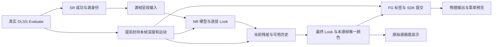

# F6 项目完整交接报告

## 0. 恢复续接完成：2026-11-12 当前候选

### 最新用户反馈与 ZZZ 日志

- F6 联合部署：用户要求“一起部署”后，2026-11-12 13:52（UTC+08）已原位部署 `5265915DF9DC34951F10E3D60CB11819EADB5FAAABD427F7F4DDA846B1360238`，正式 DLL 和原神／星铁／ZZZ 三个缓存均核验一致，原文件身份和硬链接保留。FSR 桥仍为 CC301B42；2,535 项配置／插件等受保护文件哈希不变。旧安装 8FCB8632 备份为 `build/rollback/OptiScaler-20261112T055228736-54ed1a92ea794805b190d79fb2f46ff2.dll`；旧部署回执另存 `build/f6-deploy-5265915D-previous-deployment.json`，完整核验见 `build/f6-deploy-5265915D-verified.json` 和 `build/current-deployment.json`。新版本内置 FG，保留但跳过残留 MFGUnlocker.asi；尚未观测新局加载或效果，不将部署当作 ZZZ／FG／性能验收。
- FSR 桥：按用户后续要求，当前会话新建子智能体获取 Aizawa 上游固定提交 `1865c585e02679d38881b9020611dfee8d44a9de`，隔离构建并部署到启动器实际选择的 `D:/APPS/test/TEST/HoYoShadeHub_Portable_1.4.5.0_x64_Full/temp3/Dx11FsrBridge (2).dll`。新 SHA256 `CC301B42EC7AA31059B9FCD10B29B3915B9EB21DBE363D5F431ED9201CB904A1`；旧桥 `FA27D3D7` 和原 INI 已备份，文件身份与 2,531 项受保护文件哈希保持，主会话重新独立核对全部哈希一致。三项无 GPU 测试及独立诊断 family 测试通过，不代表游戏通过。审计与回退见 [桥更新记录](../../fsr-bridge-upstream-1865c585/AUDIT.md)，机器指针 `build/current-bridge-deployment.json`；该操作未替换 F6 DLL。
- 部署前用户反馈崩铁 OK、绝区零仍未检测到 DLSS；这一反馈不自动认证新版本内置 FG、精确 FG 显示率或排队性能。ZZZ 旧局日志显示旧 F6 实际调用 `MFGUnlocker.asi`；5265915D 现已部署，待新局游戏验证。
- ZZZ PID180352 的启动器固定日志已保存为 `build/repair-20261112/zzz-180352.log`，SHA256 `9982F1F00CC16F3014D2D429B8B2C8AEAE696B1F1C0DE186FD73C4D4E22D7052`，解析结果见同目录 `zzz-180352-evidence.json`。游戏创建了两个 DLSSContext，Create／Evaluate 均记录 `owner=backend`，selected 记录为零；旧日志没有 origin/caller，无法判断具体来源拒绝分支。日志显示私有测试模块初始化，不能作为新候选实测。
- 部署前正式安装与三个游戏缓存的磁盘 DLL 均为 `8FCB8632011D46FC4FC87075516E7441F966F676A6A7CEFFD8A741AB5F6ACFA6`，四路径为硬链接，历史快照 `build/repair-20261112/zzz-180352-installed-identity.json` 保留。现安装已按上文更新为 5265915D，实际 loaded-memory SHA 仍未知。1,245 项声明输入重新验 hash 不变。
- 新候选已有游戏模块识别和同线程、同 canonical command-list 的游戏 Streamline scope fallback；独立复核未发现必然失败的代码缺陷，但这条路径不覆盖 scope 外、不同线程或其他 command-list，真实游戏是否命中尚未知。WARP caller/Router 测试不是 Streamline 到实际 SDK 的端到端验证。
- 独立复核发现冻结清单遗漏 `OptiScaler/framegen/dlssg/FgDepthContract.h`，其中 `NativeObject`／`SameOwner` 参与来源和设备判断。该文件当前 Git 无修改，两个 helper 与目前保存的生成测试夹具一致，但不能单凭这些事实认证其构建时字节；补充复核见 `build/repair-20261112/zzz-180352-review.json`，不改写原始回执。5265915D 现已部署，是否修复 ZZZ 仍需绑定新局验证。

用户要求继续中断工作后，已完成源码修复、独立静态复核、定向回归及普通内置 FG 构建；**5265915D 现已按用户授权部署，未实机验证。** 本节覆盖下方较早的暂停、未部署和 7D 阶段表述，历史证据保留原身份。

### 目标与实际状态

- 目标是排队延迟、绝区零已开启 DLSS 却提示未接入、星铁只有 NR 没有 FG；FG 使用内置实现，不使用 ASI。
- 唯一产品写树为 `D:/CODE/DLSS5_NEXT-workers/f6-rewrite`，分支 `codex/f6-rewrite`，HEAD `9ab9686`。工作树有大量既有未提交和未跟踪内容，不 reset、clean 或覆盖；本根 `D:/CODE/DLSS5_NEXT` 仅为迁移基线和导航。
- 普通内置 FG 版本 `build/out/OptiScaler.dll` 的 SHA256 为 `5265915DF9DC34951F10E3D60CB11819EADB5FAAABD427F7F4DDA846B1360238`，33,949,696 B，Release x64 构建成功、已部署、未实机验证。旧 7D 候选字节及回执保留于 `build/rollback/input-integration-7D042E99/`。
- `build/current-artifact.json`、`current-build.json` 和 `current-tests.json` 对应新版本；`build/current-deployment.json` 已更新为 5265915D 实际部署核验，旧安装回执另存，旧字节已备份；进程内字节未知。

### 候选之后的源码与验证

- `OptiScaler/hooks/FG_Hooks.cpp` 将符合条件的星铁源帧纳入既有 token lease 锁外 pacing，原 7D 版本存于 `build/repair-20261112/FG_Hooks.cpp.before`。已独立静态复核，未发现确定阻断；lease 预约失败、真实 SDK 回调、重复 Present 和显示节奏仍需实机验证。旧日志不能证明此改动改善延迟。
- `OptiScaler/hooks/ngx/NativeDx12Hooks.cpp`、`NativeDx12Router.h` 和 `OptiScaler/inputs/NVNGX_DLSS_Dx12.cpp` 调整 Create／Evaluate／Shutdown 的设备准入、持有及 COM 身份比较；相应更新设备、路由和 release 测试。目标是消除设备身份与路由不一致，具体 ZZZ 拒绝分支仍未由旧日志确定。
- 本轮进一步修复 native 调用与 Shutdown 的准入竞态、合法 Shutdown1 被无关设备拒绝、应用回调绕过生命周期准入、部分 Shutdown 释放的路由记录、已登记句柄 worker 重入等待、内部 replay 和持久参数销毁的调用来源边界。准入锁不跨厂商调用；有冲突的 selected／同句柄调用及时拒绝，不等待厂商正在等待的 worker。真实 queue／fence／Reset 退休门保留。
- 最终证据在 `build/repair-20261112/verification-next/`：`source.json` 冻结 1,245 项声明输入（不含生成版本头和全部外部传递依赖），`review.json` 记录本会话 `gpt-6.1-sol`／`high` 独立静态复核及剩余边界，`tests/tests.json` 的 17 组检查通过。设备 66 项、Router 15 套、Release 7 套、生命周期 40 项、caller 49 项、pacing／FG hook／admission 与 11 套核心 CPU／WARP 等通过；3 项独立负控及核心套件内负控按预期检出。shared 全量段明确跳过，未执行厂商推理或游戏；Streamline proxy 解包仍缺动态覆盖。
- 构建和核验日志为该目录的 `build.log`、`msbuild.log`；确认实际链接 `MfgUnlock.obj`，无私有模块／旧 ASI 对象，53 个必要 NGX 导出齐全，948 个导出名称和序号与旧普通候选一致，PE 版本核验通过，构建前后输入指纹一致。现有编译／链接警告保留，不称零警告。该目录 `previous-*` 保留原候选回执及旧 MSBuild 日志；旧 `build/repair-20261112/tests.json` 不改写为已独立复核。

### 运行证据与未知项

- 固定旧局详见 `build/runtime-tests-20261112.md`：星铁大世界源入口约 24.67 Hz，某报告 GPU 前排队 69.117 ms、GPU 区间 37.315 ms；副本也有排队尖峰。两局有 FG Dispatch 成功，但实际生成图像、显示率和唯一根因未知；星铁旧 hook 错误 8 根因亦未知。
- ZZZ 旧局 PID 197852 确有 DX12 DLSS Create／Evaluate，F6 当时将其记为 backend；旧日志没有足够信息定位具体拒绝分支。这些局有私有测试模块初始化记录，不能作为 7D 候选或当前源码的实测。

### 后续验收与边界

1. F6 5265915D 和桥 CC301B42 已完成磁盘部署核验；下一步由用户启动新局，分别验进程实际加载、画面及性能，不能用旧局反馈代替。
2. 用户手动启动游戏，每局绑定新 PID、加载 DLL 身份和固定日志，分别验证 ZZZ 输入、星铁内置 FG 输出与排队延迟。不要以旧 PID、旧日志或 SDK 接受配置代替结果。
3. 重点观察冲突准入返回失败后的恢复、部分 Shutdown 失败、真实模块委托及 SDK worker 回调；Init 与普通 native 调用并发的厂商契约、参数对象返回后的直接方法调用仍未验证。保留证据不足项，不宣称实际 FG 或延迟通过。
4. 如需继续改源码，重新冻结输入并复核／重跑受影响测试；不要直接运行固定写旧证据的 `build/record-input-integration.py`，也不要覆盖本轮 `verification-next` 回执。三个本会话新建智能体已结束，不调用旧会话实例。

始终保留用户配置和独立 SR／NR／FG 语义；资源退休必须由真实所属 queue／fence 和必要 Reset 证明，不删拒绝条件、不借旧帧、不扩大池子。本轮按用户要求部署 F6 与桥，未改 profiles 或旧根，不清理 `build/`，不操控游戏。

## 1. 7D 候选阶段：2026-11-12 历史状态

以下为 7D 候选阶段记录；其后源码状态和当前验收边界以第 0 节为准。**普通内置 FG Release x64 候选 7D042E99 已构建并通过当时的定向回归；未部署、未实机验证。** 下方历史私有候选和部署记录保留原身份。

### 目标与身份

用户目标仍为修复排队、绝区零已开 DLSS 却提示未接入、星铁只有 NR 没有 FG；FG 使用 F6 内置实现，不使用 ASI。

| 对象 | 本次事实 |
|---|---|
| 唯一产品写树 | D:/CODE/DLSS5_NEXT-workers/f6-rewrite，codex/f6-rewrite，HEAD 9ab9686；既有大量未提交改动原位保留，禁止 reset/clean |
| 当前普通内置候选 | build/out/OptiScaler.dll；SHA256 7D042E990FF913242D0ED67B0F003E6A9E1794315E29DA805C335AE302C8B6F3；33,942,016 B；Release x64 exit 0，BUILT_NOT_DEPLOYED |
| 链接与导出 | 实际重新链接含 MfgUnlock.obj，无 PrivateFgTestModule／AmpereMfgLoader／旧 ASI 对象；53 个必要 NGX 导出齐全，全部导出名称与序号和旧普通候选一致，PE 版本已核验 |
| 源码身份 | build/input-integration-source.json，845 项声明输入构建前后相同；覆盖内置 MfgUnlock 配套文件及工厂 provenance 头，不包含全部外部传递依赖或生成版本头 |
| 旧候选保留 | 8C9418B6／92D1BACE 字节与回执在 build/rollback/queue-latency-* 保留并重新核 SHA；私有 ASI 仅作历史，不生成新私有候选 |
| 当前指针 | current-artifact.json／current-build.json 指新普通内置候选，current-tests.json 对应该候选；详情 input-integration-{standard-artifact,source,tests,review}.json |
| 安装回执 | 仍为 8FCB8632011D46FC4FC87075516E7441F966F676A6A7CEFFD8A741AB5F6ACFA6，回退 65DE30C4；本次不改安装、不重新认证安装字节 |
| 本次边界 | 未部署、未改用户配置／profiles、未启动或操控游戏、未提交／推送；构建既有警告保留于日志，不称零警告 |

### 续接完成的源码与修复

- 保留既有排队、ZZZ caller、FG hook HRESULT／quarantine 和 CanSubmitInputs 准入改动；不删除真实 queue/fence/Reset 退休门，不扩大资源池或借用旧帧。
- 补菜单缺失的 hooks/FG_Hooks.h 包含；首次编译失败日志保留，最终普通产品编译成功。
- 将 MfgUnlock::Pending() 改为仅在尚未找到 provider 时等待；独立 ShouldInterceptProviderLoad() 保留后续 provider 加载处理，避免能力缓存一直等待，同时不因第一次尝试而漏掉后续模块。
- 保留旧 AmpereMfgUnlock 用户值；菜单明确提示它会阻止内置 Ada 路径，并只在用户点击按钮时关闭，保存／重启由用户决定。没有静默写用户配置。
- 独立复核确认公共 GenshinNativeQuery::Begin 的原始 Detours Begin 取得所有权后失败会遗留事务。新增 BeginDetourTransaction()，对非 ERROR_INVALID_OPERATION 的已取得所有权失败立即 Abort、保留原始错误；Abort 失败撤销 provenance，不 Abort 已存在的事务。三个原始 Begin 分支统一使用该入口，Own::Batch／Detach 不会再漏掉这类清理。
- build/record-input-integration.py 改为普通内置 FG 单构建记录；核验旧备份、链接对象、导出、PE 版本及冻结指纹后才更新候选指针，安装回执不随构建更新。

### 本次验证及边界

| 验证 | 结果 |
|---|---|
| FG Hook／Set／Create／Retire | 54 场景／1867 CPU 检查通过；绕过错误传播负控在第 3 项检出 |
| NGX caller | 42 项真实 adapter 检查通过；真实 WARP COM identity，无 GPU 命令；旧拒绝逻辑负控在第 16 项检出；proxy GUID 解包仍无动态覆盖 |
| FG input admission | 38 项通过；绕过 hook 失败门的负控在第 3 项检出 |
| 内置 FG 状态 | 41 项抽取实际谓词检查通过；恢复永久 Pending 的负控在第 3 项检出；菜单／loader 静态接线通过 |
| 工厂 Begin 清理 | 26 项实际抽取 helper CPU 检查通过，三个 wrapper 分支静态核验；覆盖已取得所有权失败／后续可 Begin、已有事务不 Abort、Abort 失败撤销；旧缺陷负控在第 2 项检出 |
| ZZZ／NGX | ZZZ scope 16 套、wiring 107 项；Router 9 套／Release 7 套通过 |
| 调度／latency | 1380 实际 wrapper CPU 检查、1065 调度检查及 options wiring 95 项通过 |
| 最终核心定向回归 | FG handoff WARP、bridge retirement WARP、ReflexQueueTiming、DlssPresetMenu、NrPresentationSource、NrPresentationOutput WARP、DlssgPacingLifetime、FgColourJoin、InteropSwapchainPolicy、NrReconfiguration、DlssgOptionsPolicy 共 11 套通过；内建负控按预期失败 |
| shared 回归 | 最终工厂 Begin 修复前执行过 shared 段并 exit 0；修复后重跑 11 套及独立 adapter，不冒称最终全量公共套件重跑 |
| 独立复核 | 当前主会话新建 gpt-6.1-sol / high；首次发现工厂事务问题，主会话核实并修复；最终窄范围复核与主会话结论见 build/input-integration-review.json |

最终逐项退出码在 build/input-integration-adapter-tests.json、build/input-integration-final-core-tests.json；完整范围在 build/input-integration-tests.json。构建日志 build/input-integration-standard-build.log／build/msbuild.log。以上不能证明 SDK 推理、实际插帧输出、游戏画面、真实显示率或性能通过。

### 最新固定实测：2026-11-12 上午

[三局固定测试记录](../build/runtime-tests-20261112.md)已保存崩铁大世界 PID129300、绝区零 DX12 PID197852、崩铁副本 PID181400 的原文／配置／SHA／解析与报告。副本完整原文 21,726,659 B，包含启动头，和启动器 16 MiB 尾段后缀匹配；末条日志自身截断。

- 大世界反馈 FG 卡顿／延迟高，记性能未通过。失焦前连续帧 107–1748 源入口约 24.67 Hz，间隔中位 40.492 ms、最高 81.398 ms；独立分析经主会话复算一致。121 份 Reflex 报告中位／P95 为 46.978／72.421 ms，最高 106.432 ms 中 GPU 前排队 69.117 ms、GPU 区间 37.315 ms；不是完整点击到显示延迟。
- 副本 447 份唯一报告中位／P95 为 45.597／85.916 ms，排队峰值 86.177 ms；单列 3.287 秒异常主要在 queue 开始前。焦点、窗口和场景不同，不能宣称改善／恶化百分比；用户未单独确认副本流畅通过。
- 两局崩铁都有 FG Dispatch 成功，不能再沿用 PID173944 的无提交状态解释它们；SDK 接受 5 张生成帧不等于实际 6× 均匀显示。
- 绝区零已按 DX12 确认成功创建／调用 DLSS，但两句柄 Create／Evaluate／Release 归为 backend，未接入 selected 输入，不是游戏没开 DLSS；具体拒绝分支仍未知。
- 三局均有 PrivateFgTestModule 初始化日志，不能记作普通内置候选 7D042E99 的实测；精确 loaded-memory SHA 未认证。本轮不改产品／用户配置、不构建、不部署、不操控游戏、不提交。

### 仍未闭环与下一验收边界

**星铁** build/starrail-fg-173944.log 的两个 hook 错误 8 底层原因仍未知。修复了确定的错误传播与事务清理问题，但不能宣称 FG 已恢复。

**ZZZ** 旧固定证据 C:/Users/thx11/AppData/Local/Temp/F6-zzz-dlss-20261112/ 证明游戏确实 Create／Evaluate DLSS；新 caller fallback 尚未实机确认。排队改善、NR 持续细节、残影、GPU 卡死、HUD 与显示／延迟仍逐项待验。

本次不部署。后续部署按目标 DLL 实际文件占用处理：可写原位保留硬链接；被占用写同目录 OptiScaler.dll.next，只记待替换；不查询或终止游戏进程。游戏由用户手动启动／进入场景；实际加载、星铁 NR＋内置 FG、ZZZ 接入及性能分别绑定新 PID、加载身份和当局固定日志。保留独立 SR／NR／FG、用户参数／profiles、内部 FSR 禁用及外部桥 2.4 ABI。

以下保留架构与历史证据；涉及旧候选、暂停或私有 ASI 的描述均服从以上最新状态。

## 2. 工作区、Git 与资料边界

| 位置 | 用途与分支 |
|---|---|
| `D:/CODE/DLSS5_NEXT-workers/f6-rewrite` | **唯一 F6 产品写树**；`codex/f6-rewrite`；在这里构建、测试和生成候选 |
| `D:/CODE/DLSS5_NEXT` | `master`；迁移基线、导航和共享逆向研究。本树的产品源码未合并 F6 工作树最新改写；在这里构建得到的是另一份基线 |
| `D:/CODE/DLSS5_NEXT/tools/research/encore-f7` | 已保存的 Encore／历史 NR 逆向、离线参考、测试和固定输入；不是 F6 运行时 |
| `D:/DATA/Documents/ChatGPT/DLSS F5 NEXT` | 旧根、旧 Git、历史日志、回退及冻结 F5 来源；保留原位 |
| `D:/CODE/DLSS5_NEXT-workers/f7-clean-rewrite` | 独立 F7 工作树和 Encore 二进制研究资料；不是 F6B2，不作为本轮写入目标 |
| `D:/APPS/test/TEST/HoYoShadeHub_Portable_1.4.5.0_x64_Full` | 实际安装根；目录名不证明启动器当前版本 |

本仓库当前没有配置远端；本次保存点都只在本机。跨机器交接时应复制完整 Git 仓库（含分支）或另行制作 bundle，并另存所需 ignored 证据；只拉取一个远端仓库不会自动得到这些本地提交。恢复相同布局时，可在导航根执行 `git worktree add D:/CODE/DLSS5_NEXT-workers/f6-rewrite codex/f6-rewrite`（仅目标目录尚不存在且分支未被其它树占用时）。

本次整理前：F6 树有 **141 个修改文件、201 个未跟踪文件**，主树有 **3 个修改文件、257 个未跟踪文件**，两树暂存区均空。有效源码、生产嵌入 shader、测试夹具、研究输入和许可均保留；没有使用 reset/clean 删除工作，也没有合并两条分支或推送。

F6 提交 `ea8c304` 完整保存此前 342 个路径。主树的共享研究和桥审阅保存于 `df97f06f5c2f7bdb3657633200d3c70f874c2697`，本次616项CPU测试通过；随后文档提交可通过下列命令定位，无须依赖 DLL 中的版本字符串：

```powershell
git -C D:/CODE/DLSS5_NEXT-workers/f6-rewrite log -3 --oneline
git -C D:/CODE/DLSS5_NEXT log -3 --oneline
git -C D:/CODE/DLSS5_NEXT worktree list --porcelain
```

其它登记工作树包括 `f6-integration`、`finaloutput-runtime`、`genshin-baseline-recovery`、`genshin-compile`（detached）、`genshin-guides`、`genshin-output`、`mod-filter`、`nr-continuity`、`nr-depth-orientation`、`nr-detail`、`zzz-input-route`、`zzz-source-clock`。本次不修改、提交、合并或清理这些树；当前分支和状态以 `git worktree list` 及各树状态为准，不能把它们当作可删除缓存。

`build/` 被 Git 忽略，但其中不仅有可重建中间件，还包含候选 DLL、部署回退、日志、源码哈希及验收回执。**Git 干净不表示磁盘没有这些资料，也不允许删除它们。** 换机器时须额外备份需要的候选、回退和原始证据；只克隆 Git 不能恢复全部运行资料。生成版本头由构建写入并忽略，主许可证和第三方署名留在 `LICENSE`、`Licenses/`、`external/`。

## 3. 用户要求与当前产品路线

原神默认是 **真实源帧呈现输入 → NR → 细节持续保留 → FG**。它指对真实源帧做一次处理，再把同一最终颜色交给正常显示和 FG，不是对每张物理输出／生成帧反复运行 NR。保留 SR 前、SR 后 NR 入口作为对照；不能把旧文档的“硬性禁止切入口”当成当前行为。



必须持续满足：

1. F6 **内部 FSR 桥及相关探测保持禁用**，实际深度／运动来自 DLSS/NGX Evaluate；外部 NGX FSR 桥仍需兼容，当前保留其 2.4 ABI。旧 FSR 捕获代码留存不等于运行时启用。
2. NR、FG 的方向、缩放和配置独立。不自动翻转纹理、修改运动 Y 符号或猜移帧号。行翻转、分量取反、深度近远约定是三种不同问题。
3. 保持用户层数、NR 绝对工作尺寸／百分比、Look、效果、历史时长及 FG 倍率。比较 SR 前／后／呈现入口时，必须记录实际工作像素数；相同百分比未必同绝对分辨率。
4. 源帧、SDK token、生成输出、物理显示 owner 分开。源事务只执行一次；生成回调不推进源时钟，不重复 pacing，也不再次加工已处理颜色。
5. 正常源画面和 FG 使用同源、同代次的最终颜色；失败／跳过选择本帧结果，不能拿旧 NR 成品冒充当前结果。
6. 资源的提交、读写交接和退休只能由实际所属 queue/fence/value 及 recording Reset 证明。CPU 返回、Ready、观察快照和窗口 ACK 不能替代；不能删等待或盲目扩池掩盖断链。
7. 没有 HUD 输入时继续 FG，明确“UI 未保护”。SDK 自行生成插帧，不要求应用给每张生成帧补交一套假深度／运动。
8. 复用原有预览条，一次选一路；不恢复转头校准向导、常驻评分 worker 或低清 CPU 格子画布。菜单关闭后预览仍可显示，选“关闭”停止新增采样。

## 4. 代码与接口导航

下表路径统一相对产品工作树的 `OptiScaler/` 目录。优先沿实际调用链读，历史行号可能已变化。

| 模块 | 关键位置 | 责任 |
|---|---|---|
| NGX 入口 | `inputs/NVNGX_DLSS_Dx11.cpp`、`inputs/NVNGX_DLSS_Dx12.cpp`、`inputs/NgxFeatureRegistry.h` | 真实 Evaluate、feature 与本次参数身份 |
| 源描述与观察 | `runtime/GuideSourceMetadata*.h`、`runtime/InputObservation.h`、`framegen/GuideOrientation.h` | 不可变源元数据、字段来源、方向；观察结果不授权退休 |
| NR 源准入 | `runtime/NrPresentationSource.h`、`shaders/dlssnr/DlssNr_GenshinPresentation.inl` | 源连续性、单次 claim、呈现入口 |
| NR 执行 | `shaders/dlssnr/DlssNr_Dx12.cpp`、`shaders/dlssnr/DlssNr_Late.inl`、`dlssnr/DlssNrFeature_Dx12.h` | 模型、多层、Look、最终结果和热重建 |
| 当前颜色事务 | `runtime/NrPresentationOutput.h`、`framegen/dlssg/FgColourJoin.h` | 私有处理与一次发布；避免不同源颜色汇合 |
| 持续细节 | `shaders/dlssnr/DlssNr_DetailHistory.inl`、`shaders/dlssnr/DlssNr_DetailHistoryPolicy.h`、`shaders/dlssnr/precompile/dlssnr_detail_history.hlsli` | 逐源帧残差历史、像素拒绝与最终稳定 |
| 旧间隔复用 | `dlssnr/DlssNrDetailReuse*.h`、`shaders/dlssnr/DlssNr_DetailReuse.inl` | 旧的少跑模型路径，和持续保留分开 |
| recording 生命周期 | `shaders/dlssnr/DlssNr_RecordingLifetime.h`、`shaders/dlssnr/DlssNr_WatchedLists.h`、`runtime/FenceCompletion.h`、`runtime/GpuWorkDomain.h` | 真实 queue、Use、完成和 Reset 边界 |
| GPU 计时 | `shaders/dlssnr/DlssNr_GpuTime.h` | 复用真实 recording fence；不另建 Signal |
| FG 与 SDK 状态 | `framegen/dlssg/DLSSG_Dx12.*`、`framegen/DlssgStateSample.h`、`framegen/dlssg/DlssgOptionsPolicy.h` | 实际 tag、GetState 区间、选项及 SDK 提交 |
| Pacing 与 latency | `hooks/FG_Hooks.cpp`、`framegen/DlssgPacingLifetime.h`、`framegen/FgPacingLease.h`、`framegen/FgSourcePacing.h`、`framegen/FrameLatencyOwnership.h` | 锁外等待、每源一次、waitable 对象所有权 |
| DX11／DX12 交接 | `with_dx12/dx11_with_dx12_sc.cpp`、`upscalers/IFeature_Dx11wDx12.*`、`native/Dx11FrameSource.cpp` | source queue、共享颜色 reader/writer、输出 owner |
| SDK／物理输出 | `hooks/Streamline_Hooks.*`、`wrapped/wrapped_swapchain.*`、`wrapped/SwapchainHookBoundary.h` | SDK 与物理输出分离；外部桥包装器 ABI |
| 单选 GPU 预览 | `runtime/GuideCapture.*`、`runtime/GuidePreview.inl`、`shaders/preview/GuidePreviewShader.h`、`menu/GuideDiagnosticsMenu.*`、`menu/menu_overlay_dx.cpp` | 按需快照、生产与 renderer 读取租约 |
| 配置与 UI | `Config.*`、`dlssnr/DlssNr_Menu.cpp`、`menu/NextgenLookControls.h`、`nvapi/NvApiHooks.cpp` | 独立设置、Look 最终画面、SR/FG 模型选项 |
| 其它游戏 | `upscalers/GameRoutePolicy.h`、`runtime/StarRailResidencyPolicy.h`、`inputs/FG/` | 星铁／ZZZ 的输入、source/SDK/owner 分流；逐游戏验收 |

表中所有路径（包括 `runtime/`）均在 `OptiScaler/` 下；`*`仅用于表示同模块头／实现等多个文件。

## 5. NR 细节持续保留：当前设计与未闭环问题

**逐源帧完整模型计算**和旧的“间隔运行模型再复用成品”是独立路径。持续保留启用时独占其残差历史，不因历史拒绝而回落旧间隔历史。历史保存 NR 相对当前原画的残差／原始结构／年龄；显示融合结果不能再次存回长时原始历史，否则会放大拖尾和跨表面污染。

历史须满足同源域、连续性、区域／缩放、有效变换、真实完成及像素表面约束。已有跨表面修复限制 donor 和非零中央 tap 与当前表面相容；缺 guides、无连续性或未完成时继续当前 NR。模型、尺寸、层数、方向及历史参数变化须清除不兼容历史，并从当前入口推进安全重建，无需切出窗口。

当前 UI 提供独立的每帧历史调试窗和共用参数；必须分别观察“收到／准入／已录制／已提交／完成／非零贡献”，不能用模型成功、历史发布或窗口全绿证明像素有效。图像预览与贡献图是证据，观察状态不是资源凭据。

| 设置／配置字段 | 当前语义与默认值 |
|---|---|
| `DlssNrPresentedTemporalDetail` | 持续保留总开关，默认 false；不等同 `DlssNrDetailReuse` |
| `DlssNrPresentedTemporalDurationMs` | 长时残差衰减时间，0～2000 ms，默认 0；0 关闭长时携带 |
| `DlssNrPresentedTemporalMaxAgeMs` | 历史年龄上限，16～5000 ms，默认 500；与衰减时间不同 |
| `DlssNrPresentedTemporalStrength` | 默认 0.85 |
| `...DepthTolerance`／`...ColourTolerance` | 每帧路径独立容差，默认均 0.08 |
| `...MotionTolerance`／`...NoiseFloor` | 默认 2 工作像素／0.01 |
| `DlssNrPresentedTemporalStabilityMs` | 最终稳定的时间常数，0～2000 ms，默认 0 关闭；不是冻结整帧或精确时间窗 |
| `...StabilityFloor`／`...StabilityClamp` | 低可信稳定比例默认 0.65、外观变化容差默认 0.08 |

最终稳定只平滑当前残差，状态独立于长时原始历史；总开关打开时可在长时保留时长／强度为 0 的情况下独立工作。坏深度／运动不等于无条件接受整帧旧画面；仍保留真实相邻源、外观变化、逐通道上限和重置门。较大稳定参数可能拖尾，尚未完成游戏验收。开启时使用两张模型尺寸 FP16 状态纹理，关闭不分配该组状态。

用户仍报告全屏拒绝、转镜头丢细节而发白、光源与噪声频繁变化，之前还有 1 秒栅栏分身和人物细节投到地面。应先在每帧调试中确认实际参数、拒绝图、最终稳定权重及源帧年龄，再用同对真实输入定位；不要再靠只放宽准入、给旧帧续命或把非零贡献当画质通过解决。

## 6. 已完成、待验证与暂未实现

| 项目 | 当前事实／验收边界 |
|---|---|
| 呈现 NR＋FG 主链 | 7C281A54 的明显卡顿／旧帧闪回获用户确认解决；关键队列与颜色交接须保留 |
| 持续历史与最终稳定 | 已有独立实现、滑条、每帧调试和生产 shader 测试；81DBE9A5 已部署，但用户效果与卡死问题未通过 |
| Look | PID164004 的 24 次 resolve 均为 `debugView=2`，原始模型预览遮住最终 Look。DD53514B 在实际改 Look 或点击“查看最终效果”时返回最终画面；仅浏览不改设置、不强启 NR。修复随EA3059BA部署，实机未验收 |
| GPU 计时开销 | DD53514B 去掉 timer 自建 fence／重复 Signal，query/readback 绑定真实 recording Use；GPU 完成才读，Reset＋完成才复用。没有新增 CPU wait |
| GPU 分段 | 前 3 次及每 64 次 dispatch 增加 6 个 timestamp，形成 7 个不重叠区间。它是同 queue 时间跨度，不是独占 GPU 活跃时间 |
| SR J/K/L/M | 已接配置和现有 SR 重建流程；菜单选择不证明 SDK 实际加载该模型 |
| FG A/B/C | 已接进程内 NVAPI 查询覆盖，保存后重启；PID175744 的 SDK 明确接受 C，其它选择及可靠热切换未验；不写驱动 profile |
| 本机私有 6× FG 测试 | 独立外部模块接入已构建部署；普通构建关闭专用接入，不附带 ASI。旧内置实现退出产品编译／调用／配置／菜单，旧源文件只保留作离线参考；实际初始化及 6× 输出未验 |
| HUD 保护 | 已有 HUD-less/UI 色＋Alpha 标签及同源双标签条件；外部桥生产回调和 alpha-only ABI **尚未接入**。见 [HUD 合同](FG-BRIDGE-HUD-CONTRACT.md) |
| 轻微 FG 残影 | 世界／人物与 UI 问题分别观察；没有证据证明固定一帧错配、双重取反或某一 Y 设置是统一根因 |
| 预览与 FPS | 已有单选全分辨率 GPU 路线、按需采集和分类帧率统计；关闭退休后的静默及三游戏可用性仍需实机检查 |
| F6B2 | 用户允许必要时从 F5 重写；当前仍为 F6，**没有建立并交付从 F5 整体回退的 F6B2** |

已撤回两类归因：旧局其它模块不能用来解释“仅加载 OptiScaler”的本局；此前夹具误将输入描述符当输出描述符，制造了 36 项“旧色”失败，已修正并撤回冗余产品改动。**不能再宣称修复旧色读取、因此省去一次生产全屏复制，或已据此证明游戏残影根因。**

## 7. 性能调查：已知成本与仍未知的根因

权威明细见 [F6-PERFORMANCE-REVIEW.md](F6-PERFORMANCE-REVIEW.md)。以下是固定旧局的数据，不能当最新候选性能。

| 证据 | 结果与限制 |
|---|---|
| PID153992，报告帧33333 | Reflex 报告 166.103 ms；同报告端点拆为 GPU 开始前 62.987、GPU 跨度 58.481、GPU 结束到报告尾端 44.635 ms。不是完整点击到显示延迟，也不是纯 NR 成本 |
| PID164004，317 对同 dispatch/epoch/queue/list | NR total 中位 39.630 ms、model 中位 31.759 ms、逐对模型外差值中位 5.288 ms。稀疏采样且设置变化，不能把三项中位数相加或当整局平均 |
| PID164004 尾段共享 reader 等待 | 83.962／98.681／22.469 ms，目标23032／23033／23034，完成值均差1；是实际 copy reader CPU 等待，父复制跨度已包含它 |
| 同局另一个等待边界 | 隐藏 DX11 Present 为 101.810／92.761／173.323 ms；不能与包含区间或不同帧峰值累加 |
| 单共享颜色槽 | 普通 interop 虽有至少3个 allocator，但本局 `bufferCount=1`，34条输出 copy-wait 都在 slot0。只轮转 allocator 不能解决共享纹理 reader 未退休 |
| 资源与日志 | 已抽样 registry 未见持续堆积，不是全局无泄漏证明；日志74,581,959 B／717,054行，量大但未测得日志阻塞时长 |
| SDK 及显示计数 | 实际 GetState 是查询间累计值，不能用请求倍率＋1代替；LocalPresent 突发、菜单回调和120 FPS录像编码均不证明真实显示率 |

首个长等待发生在失焦记录之前，不能把全部问题归给之后 FG 关闭。SDK flush、队列入口前成本、共享 reader、隐藏 Present 和报告尾段仍须在**同一 source／queue 时间线**关联。DD53514B 修计时浪费和 Look 冲突，但 **160 ms 的唯一根因与实际改善尚未闭环**；不能删除真实完成等待、猜测重排 SDK 输出或降低用户画质宣称提速。

## 8. 历史候选、部署、加载和回退身份（当前以第 1 节为准）

| 对象 | 精确信息 |
|---|---|
| 历史私有候选 DLL | `D:/CODE/DLSS5_NEXT-workers/f6-rewrite/build/private-fg-test/out/OptiScaler.dll`；`PrivateTestOnly=true`、`Publishable=false` |
| 候选 SHA256 | `92D1BACEE1A07CE0C3064C27F16AEE648A5334A8C1189F789AB92E688E38DD9C`，已构建、未部署 |
| 候选构建 | Release x64 exit 0，33,902,592 B；53 个既有 NGX 导出、版本资源及实际链接已核验 |
| 候选文件时间 | UTC `2026-11-11T23:36:58.989565Z`，北京时间 2026-11-12 07:36:58 |
| 普通构建 | `build/out/OptiScaler.dll`；SHA256 `8C9418B66DBBB1C61358A09AE3CA1107479FAD2FEEC3D93992718AAB40DFEC1F`，33,896,960 B；无 ASI／专用摘要／旧实现对象；未部署 |
| 测试 ASI | 四处 DLL 同目录 `plugins/MFGUnlocker.asi`；SHA256 `171AC18D4D632D12DEE22D5CAF2085F301BACFDB9A462561D93DBCBB61D6A4F8`，7,389,184 B；重试仅复核 |
| 已安装 DLL | `D:/APPS/test/TEST/HoYoShadeHub_Portable_1.4.5.0_x64_Full/OptiScaler/official/F6/OptiScaler.dll` |
| 已安装 SHA256 | `8FCB8632011D46FC4FC87075516E7441F966F676A6A7CEFFD8A741AB5F6ACFA6` |
| 安装回执 | 2026-11-12 06:13:11 部署、06:14:02 部署侧核验（UTC+08）；4 路径同一原 File ID，7 份配置与重试前快照一致，主会话独立核验通过 |
| 已有旧局 | AE53A7CC 部署后的 PID175744 已分析；384 份唯一报告、65 份 NR 分段，不证明 8FCB8632 已加载 |
| loaded-memory SHA | **未知**；日志版本＋磁盘部署只提供关联证据 |
| 上一安装回退 | `current-deployment.json` 的 `Rollback`；SHA256 `65DE30C47EFC9781D3A5F393E5979155249B1E08710F273F98C01F0F94A774F2`，33,969,152 B |

当前两种构建基于 `9ab9686` 加工作树改动；`build/queue-latency-source.json` 的826项指纹在构建前后匹配，范围为既有显式输入及本轮共享策略头，不包含全部外部传递依赖或生成版本头。8FCB8632、604B2482和65DE30C4均另存 `build/rollback/`；旧external-fg回执保留部署阶段身份。

首次占用仅暂存，用户确认退出后重试成功。七配置以 `build/external-fg-retry-configs-20261111T221309759.json` 为基线；此前原神 profile／cache 配置变化已保留，没有恢复旧快照。正式目录 `.next` 与已安装字节相同，作为先前暂存保留，已不属待部署。

`current-deployment.json` 的 `Artifact` 是部署发生时的源路径；同一路径可被后续候选覆盖，不能仅跟随该路径认定当时部署字节，必须核对回执 SHA 与安装文件。

## 9. 构建、shader、测试和已验证范围

在产品写树执行，需要 PowerShell 7、MSVC v143；本机 MSBuild 为 `D:/VS2022BuildTools/MSBuild/Current/Bin/amd64/MSBuild.exe`。

```powershell
Set-Location D:/CODE/DLSS5_NEXT-workers/f6-rewrite
pwsh -NoProfile -File ./build.ps1
# 明确需要清缓存时才加 -Clean；需要时用 -Jobs N
```

输出 `build/out/OptiScaler.dll`；UTF-8 日志 `build/msbuild.log`。普通构建使用现有嵌入头，**不需要重生成 shader**。只有修改 HLSL 时才按既有 `tools/shaders/README.md` 和 `OptiScaler/shaders/dlssnr/precompile/build_detail_reuse.ps1` 等配套 recipe 同步 DXIL、SPIR-V、嵌入头与测试；不要只改 HLSL 却部署旧字节码。

当前普通内置 FG 单构建已完成；私有参数与构建分支已移除。最新候选和验证见第 1 节，以下双候选检查保留历史。

历史私有模块校验、worker 初始化和有界等待已退出当前产品接入，仅保留旧证据，不再执行该方案。

本轮92D1BACE／8C9418B6通过1380项抽取真实wrapper的CPU检查、1065项源调度检查及6套定向回归；两种旧setter负控分别检出SDK限深越权和native/provider错路由，options静态连接95项。具体计数与范围见 `build/queue-latency-tests.json`，gpt-6.1-sol/high独立复核无确定代码blocker。未全量重跑shared、未运行游戏，不能证明排队改善。

8FCB8632阶段通过 31 个独立进程模块场景（含 26 种无效 proof）、真实 Windows TLS／main／worker 共 5 检查，以及 DlssgOptionsPolicy、FgHandoffWarp、DlssgPacingLifetime、ReflexQueueTiming、NrPresentationSource、NrPresentationOutputWarp、InteropSwapchainPolicy、NrReconfiguration 共 8 套核心回归。模块正向场景使用受控摘要，真实 IO／CNG 保留，loader／export／memory proof 被 mock；代理未执行用户 ASI、未进游戏、未全量重跑 shared 回归。独立复核无剩余确定 blocker，不能据此宣称实际 6× 输出或画面／性能通过。

65DE30C4 阶段：15 套核心定向回归，3763 项像素、526 项表面、796 项 timer WARP 检查，18 个历史 runtime 场景，两个物理 GPU 生产 DXIL 场景各 329 项，解析器 13 项通过。运动负控同 3763 检查出现 48 项预期失败，原 birth-reference 缺陷负控亦检出；整套 shared 回归未全量重跑。下方表格和命令保留为 DD53514B 等历史验证范围：

```powershell
pwsh -NoProfile -File ./tools/tests/Run-CommonCoreTests.ps1 `
  -SuiteName NrGpuTimeWarp,LookControls,NrColourTransaction,NrLayerLookWarp,NrPresentationSource,NrPresentationOutputWarp,NrDetailHistoryRuntime,FgHandoffWarp,FgColourJoin,DlssgPacingLifetime,ReflexQueueTiming,DlssgOptionsPolicy,NrWatchedLists,NrReconfiguration
```

| 历史保存结果 | 范围 |
|---|---|
| Look 控件80检查 | 实际修改／查看最终效果的预览状态 |
| 生产 Look HLSL/WARP392检查 | 正确输入／输出描述符、最终合成；不执行 NGX |
| GPU timer WARP668检查 | 真实 registry/fence、延迟完成、Reset、重放、Signal失败、在途析构 |
| 持续历史 runtime 18场景 | 真实宿主生命周期、拒绝与重建 |
| FG handoff 15场景／564检查 | 旧 queue、延迟 guides、缺 writer wait 负控均可检出 |
| 呈现输出 WARP1596检查 | 当前颜色输入、发布与状态恢复 |
| shared、pacing、Reflex、options、热重建 | 统一 runner 对应套件通过，整体 exit 0 |
| 错误颜色域负控 | 预期 exit 1、148检查中24项像素失败；这是成功检出错误，不是正向回归失败 |

81DBE9A5 的上一批历史 shader另有3281检查、两组 NVIDIA `10DE:28E0` 各40帧／329检查等回执，详见原记录；不要合并成 DD53514B 本次新跑计数。所有这些均不能证明 NVIDIA NGX 推理、游戏画面、真实显示率或延迟已通过。

专用部署聊天已部署 8FCB8632；主会话核对四路径 DLL／ASI、原 File ID／硬链接、重试前七配置、825 项源码指纹及 65DE30C4 实际回退字节。NR 持续效果、草地 FG 对照、SR 应用与提速仍待游戏验证。

## 10. 证据怎么找、怎么读

产品树 `build/` 中的当前指针：

| 文件 | 用途 |
|---|---|
| current-build.json／current-artifact.json | 普通内置 FG 5265915D，已构建未部署；以第 0 节完整 SHA 核验字节 |
| queue-latency-{source,tests,review,builds}.json | 旧排队阶段 826 项及双候选证据，不覆盖后续 ZZZ／星铁／内置 FG 全部改动 |
| `current-tests.json` | 与候选关联的验证范围及撤回项 |
| `current-deployment.json`／`external-fg-deployment.json` | 8FCB8632 正式部署、四处 DLL／ASI、七配置与实际 65DE30C4 回退字节 |
| `external-fg-source.json`／`external-fg-{tests,review}.json` | 8FCB8632阶段825项输入指纹、定向验证与独立复核；不代表本轮源码 |
| `external-fg-{private,standard}-artifact.json`／`external-fg-*-build.log` | 两种构建、实际重链、全部 NGX 导出及发布隔离检查 |
| `external-fg-main-verification.json` | 主会话部署后独立复核：四路径、硬链接、重试配置基线、回退和源码指纹 |
| `external-fg-deployment-retry-preflight.json`／`external-fg-retry-configs-20261111T221309759.json` | 本次成功重试前的 DLL 身份及七配置快照；不以旧快照覆盖用户新设置 |
| `nr-followup-source.json`／`nr-followup-review.json` | 65DE30C4 阶段 34 项源码指纹及独立复核，NR 整体消失仍未确诊 |
| `nr-followup-*.log`／`shaders/detail-surface/result.json` | 65DE30C4 阶段构建、导出、定向回归、分阶段负控及生产 shader 身份 |
| `latency-followup-source.json` | 构建前后核对的21项关键源码哈希，声明不是完整干净提交证明 |
| `latency-followup-{build,regression,exports}.log` | 构建、回归与真实导出 |
| `latency-followup-previous-*.json` | 上一63DD候选等旧回执，保留原身份 |
| `history-tuning-source.json` 等 | 81DB及此前历史参数修订的来源范围 |
| `handoff-git-inventory.json` | 本次整理前逐路径哈希及凭据模式扫描；不是构建证明 |
| `rollback/` | 原位部署前的原字节备份，不保证每件都是良好候选 |

PID164004 完整原日志当时位于安装根 `OptiScaler/official/F6/OptiScaler.log`，**74,581,959 B／717,054逻辑行**；活动别名会被新局覆盖。先核对 PID、起止时间和内容，优先用启动器 `log/sessions/<session>/session.txt` 绑定的固定快照；16 MiB旋转尾段不能当完整会话。若原件已替换，明确证据缺失，不拿新局或摘要填补。

核对旧完整日志的定位行：714831／714873／714913 为 copy reader wait，714838／714878／714917 为 `fakeIndex=0/bufferCount=1`，714980／715068／715276 为隐藏 Present。行号只适用于该原文。帧18665的297.169 ms被重复上报，不是两个新帧；另一个帧18687为192.338 ms，不能混记。

```powershell
# 用固定日志、真实PID和日志内构建版本运行；以下占位符必须替换
pwsh -NoProfile -File ./tools/runtime/Get-F6RunEvidence.ps1 `
  -Log '<固定日志绝对路径>' -ExpectedPid <PID> -ExpectedCommit '<日志内commit>' `
  -Output ./build/run-evidence.json

# 用户进入游戏后，固定参数预热5秒、采集30秒
pwsh -NoProfile -File ./tools/runtime/Collect-F6DisplayTiming.ps1 `
  -TargetPid <PID> -PresentMonPath '<PresentMon.exe绝对路径>' `
  -CandidateDllPath '<对应磁盘DLL绝对路径>' -WarmupSeconds 5 -DurationSeconds 30
```

日志解析器拒绝PID／版本不符和读取中变化；日志计数可能限频，不是完整调用数。显示采集若没有真实 display change事件，应报告“实际显示率未知”，不能用Present入口或SDK累计替代。一次性同源双帧导出与八方向离线比较见 [诊断操作](F6-GUIDE-DIAGNOSTICS.md)，不自动写方向配置。

用户提供的录像原件在 `D:/DATA/video/`，包含 `2026-11-10 13-41-34.mp4`、11月11日的 `04-05-26`、`04-21-14`、`04-58-00.mp4`。编码100/120 FPS不能代替扫描更新率；帧内容重复率只能作为像素线索。

## 11. 部署与验收顺序

历史 F6 专用部署聊天为 01a1cbf3-6888-7611-a4e9-fbece85fcf60。本次普通内置 FG 5265915D 候选已构建未部署；后续部署须按第 0 节完整 SHA 核验，不使用旧私有候选。部署会话只部署及写回执，不改源码／说明／profiles，不启动或操控游戏。

8FCB8632 已由该部署聊天原位部署完成。用户明确要求：**部署不再查询游戏进程或判断游戏是否运行**。用户的星铁、ZZZ通常由其它方式启动，进程存在不代表占用F6；后续只按目标DLL的实际文件占用处理，不终止游戏进程。

以下为当前普通内置 FG 候选的后续部署参考，本次不执行；先核验完整 SHA，不使用历史私有候选。

```powershell
$candidate = Get-Content -LiteralPath ./build/current-artifact.json -Raw | ConvertFrom-Json
if ($candidate.PrivateTestOnly) { throw '旧私有候选不可用于内置 FG 接续部署' }
if ((Get-FileHash -LiteralPath $candidate.Artifact -Algorithm SHA256).Hash -ne $candidate.SHA256) {
  throw 'Candidate SHA256 mismatch'
}
pwsh -NoProfile -File ./tools/runtime/Deploy-F6.ps1 -Artifact $candidate.Artifact
```

脚本流写原文件对象、保留硬链接并备份旧字节，失败尝试原位恢复；脚本返回成功后还须核对4路径哈希、File ID／hardlink、7份配置及当前部署回执。它本身不证明实际加载或游戏通过。回退也用已核字节和原位流程，不能 rename/replace 打断硬链接；回退身份以本次回执为准，备份不自动代表已知良好。

当前 FG 用内置，不部署新 FG ASI。安装回执中 ASI 仅属历史；本轮未清理安装目录，新普通候选跳过残留 mfgunlocker.asi 并保留其它插件。

若独占打开目标DLL遇到实际共享／锁定／映射占用，脚本把已核验候选写在正式DLL旁边的 `OptiScaler.dll.next`，返回 `STAGED_NEXT_FILE_IN_USE` 和 `PendingArtifact`；正式DLL及其硬链接不动。已有 `.next` 仅在新文件完整写入并核验后更新；权限或磁盘等其它错误仍报错。此结果只记待替换，不能更新 `current-deployment.json` 为新候选已部署。占用解除后，再以候选或 `.next` 作 `-Artifact` 执行同一原位流程并核验；不通过重命名覆盖正式DLL。脚本不自动替换、不启动后台轮询。

后续建议按证据推进：

1. 用户恢复且新普通内置 FG 候选构建及后续部署完成后，手动启动并核对 source hook、SDK 调用和真实显示输出；分别复测星铁／ZZZ 接入，再验 NR 持续效果、同景 FG 开／关、SR、恢复与 Look。固定场景及参数采延迟，分开启停与稳态。
2. 原神依次 **SR → SR＋NR → SR＋FG → SR＋NR＋FG**，每组预热5秒采集30秒；区分细节保留关闭、持续保留、最终稳定，记录实际模型尺寸、层数、入口及源/SDK/显示率。
3. 重点验旋转镜头发白、1秒栅栏／人物跟随、非零历史贡献、遮挡／显露、切场景、热调节不用切窗和卡死恢复；无HUD时单列UI未保护。
4. 在同一源/queue时间线上拆分共享reader、hidden Present、pacing、模型外7段和报告尾部；先测SDK flush原因，再决定是否改共享颜色生命周期。不能只轮转allocator或删真实wait。
5. 若FG独立仍有世界／人物残影，导出同一对源帧及实际FG tag纹理，验证rect、scale、jitter、方向和颜色代次；证据不足保留未知。
6. 原神、星铁、ZZZ 分别记录验收，当前星铁／ZZZ 接入按第 1 节继续；跨游戏、跨候选和旧验收不能互相代替。

通过门槛包括：当前guides确实使用、有效历史有非零且正确跟随的贡献、无旧帧闪回／跨表面分身、调参后可恢复、关闭预览退休后静默、固定画质下真实显示节奏与延迟改善。120Hz目标只有真实显示事件达到才记通过，缺测量记未知，未达记性能未通过。

## 12. 新会话续接提示

> 先读第 0 节。用户要求“一起部署”后，F6 内置 FG 修复版 5265915D 与桥 CC301B42 已部署，待新局实测。正式 F6 与三个游戏缓存 SHA 一致、原文件身份／硬链接不变，旧安装 8FCB8632 已备份，2,535 项保护文件不变。唯一写树 D:/CODE/DLSS5_NEXT-workers/f6-rewrite，HEAD 9ab9686，保留全部未提交内容。FG 使用内置实现、跳过残留 MFGUnlocker.asi。后续分别验 ZZZ 输入、星铁内置 FG 输出与排队改善，不能用旧局反馈或 SDK 接受代替实际结果。
