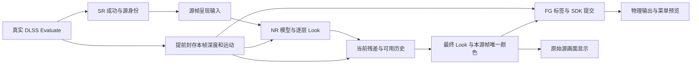

# F6 项目完整交接报告

更新：2026-11-12（Asia/Shanghai，UTC+08）。本报告是当前产品的接手入口；[当前状态](CURRENT-STATE.md)提供简要状态，[外部参考仓库清单](../../../DLSS5_NEXT/docs/REFERENCE-REPOSITORIES.md)列出来源、实际位置和采用边界。

## 1. 先读结论

- **代码已保存**：累计产品改写、未跟踪源码、测试、工具及原有说明已保存到 `codex/f6-rewrite` 的提交 **`ea8c304c3810408e4ec8c7ca1378718cc37cd02a`**。本次随后只整理交接、导航和 Git 忽略说明，没有继续修改产品算法。
- **最新候选 DD53514B 已构建、未部署**；正式安装仍是 **81DBE9A5**。构建、部署、实际加载、画面和性能必须分别记录。
- 用户确认 **7C281A54 解决了呈现 NR＋FG 的明显卡顿和旧帧闪回**。保留其共享 source queue、Evaluate 提前封存 guides、同源最终颜色汇合和真实交接机制；这不代表此后所有候选及细节历史均通过。
- **持续细节保留、旋转视角发白／噪声稳定、卡死恢复、轻微 FG 残影、HUD 保护、高延迟及三游戏回归仍未验收**。不要继续把 11 月 8 日的 7→27 FPS 旧失败写成最新状态，也不要把离线通过替代游戏通过。
- 最新检索和复核按用户要求使用 **gpt-6.1-sol / high**；此前 DS 审查只是线索，Lead 已重读生产链路和原始日志，撤回了错误归因。

## 2. 工作区、Git 与资料边界

| 位置 | 用途与分支 |
|---|---|
| `D:/CODE/DLSS5_NEXT-workers/f6-rewrite` | **唯一 F6 产品写树**；`codex/f6-rewrite`；在这里构建、测试和生成候选 |
| `D:/CODE/DLSS5_NEXT` | `master`；迁移基线、导航和共享逆向研究。本树的产品源码未合并 F6 工作树最新改写；在这里构建得到的是另一份基线 |
| `D:/CODE/DLSS5_NEXT/tools/research/encore-f7` | 已保存的 Encore／历史 NR 逆向、离线参考、测试和固定输入；不是 F6 运行时 |
| `D:/DATA/Documents/ChatGPT/DLSS F5 NEXT` | 旧根、旧 Git、历史日志、回退及冻结 F5 来源；保留原位 |
| `D:/CODE/DLSS5_NEXT-workers/f7-clean-rewrite` | 独立 F7 工作树和 Encore 二进制研究资料；不是 F6B2，不作为本轮写入目标 |
| `D:/APPS/test/TEST/HoYoShadeHub_Portable_1.4.5.0_x64_Full` | 实际安装根；目录名不证明启动器当前版本 |

本仓库当前没有配置远端；本次保存点都只在本机。跨机器交接时应复制完整 Git 仓库（含分支）或另行制作 bundle，并另存所需 ignored 证据；只拉取一个远端仓库不会自动得到这些本地提交。恢复相同布局时，可在导航根执行 `git worktree add D:/CODE/DLSS5_NEXT-workers/f6-rewrite codex/f6-rewrite`（仅目标目录尚不存在且分支未被其它树占用时）。

本次整理前：F6 树有 **141 个修改文件、201 个未跟踪文件**，主树有 **3 个修改文件、257 个未跟踪文件**，两树暂存区均空。有效源码、生产嵌入 shader、测试夹具、研究输入和许可均保留；没有使用 reset/clean 删除工作，也没有合并两条分支或推送。

F6 提交 `ea8c304` 完整保存此前 342 个路径。主树的共享研究和桥审阅保存于 `df97f06f5c2f7bdb3657633200d3c70f874c2697`，本次616项CPU测试通过；随后文档提交可通过下列命令定位，无须依赖 DLL 中的版本字符串：

```powershell
git -C D:/CODE/DLSS5_NEXT-workers/f6-rewrite log -3 --oneline
git -C D:/CODE/DLSS5_NEXT log -3 --oneline
git -C D:/CODE/DLSS5_NEXT worktree list --porcelain
```

其它登记工作树包括 `f6-integration`、`finaloutput-runtime`、`genshin-baseline-recovery`、`genshin-compile`（detached）、`genshin-guides`、`genshin-output`、`mod-filter`、`nr-continuity`、`nr-depth-orientation`、`nr-detail`、`zzz-input-route`、`zzz-source-clock`。本次不修改、提交、合并或清理这些树；当前分支和状态以 `git worktree list` 及各树状态为准，不能把它们当作可删除缓存。

`build/` 被 Git 忽略，但其中不仅有可重建中间件，还包含候选 DLL、部署回退、日志、源码哈希及验收回执。**Git 干净不表示磁盘没有这些资料，也不允许删除它们。** 换机器时须额外备份需要的候选、回退和原始证据；只克隆 Git 不能恢复全部运行资料。生成版本头由构建写入并忽略，主许可证和第三方署名留在 `LICENSE`、`Licenses/`、`external/`。

## 3. 用户要求与当前产品路线

原神默认是 **真实源帧呈现输入 → NR → 细节持续保留 → FG**。它指对真实源帧做一次处理，再把同一最终颜色交给正常显示和 FG，不是对每张物理输出／生成帧反复运行 NR。保留 SR 前、SR 后 NR 入口作为对照；不能把旧文档的“硬性禁止切入口”当成当前行为。



必须持续满足：

1. F6 **内部 FSR 桥及相关探测保持禁用**，实际深度／运动来自 DLSS/NGX Evaluate；外部 NGX FSR 桥仍需兼容，当前保留其 2.4 ABI。旧 FSR 捕获代码留存不等于运行时启用。
2. NR、FG 的方向、缩放和配置独立。不自动翻转纹理、修改运动 Y 符号或猜移帧号。行翻转、分量取反、深度近远约定是三种不同问题。
3. 保持用户层数、NR 绝对工作尺寸／百分比、Look、效果、历史时长及 FG 倍率。比较 SR 前／后／呈现入口时，必须记录实际工作像素数；相同百分比未必同绝对分辨率。
4. 源帧、SDK token、生成输出、物理显示 owner 分开。源事务只执行一次；生成回调不推进源时钟，不重复 pacing，也不再次加工已处理颜色。
5. 正常源画面和 FG 使用同源、同代次的最终颜色；失败／跳过选择本帧结果，不能拿旧 NR 成品冒充当前结果。
6. 资源的提交、读写交接和退休只能由实际所属 queue/fence/value 及 recording Reset 证明。CPU 返回、Ready、观察快照和窗口 ACK 不能替代；不能删等待或盲目扩池掩盖断链。
7. 没有 HUD 输入时继续 FG，明确“UI 未保护”。SDK 自行生成插帧，不要求应用给每张生成帧补交一套假深度／运动。
8. 复用原有预览条，一次选一路；不恢复转头校准向导、常驻评分 worker 或低清 CPU 格子画布。菜单关闭后预览仍可显示，选“关闭”停止新增采样。

## 4. 代码与接口导航

下表路径统一相对产品工作树的 `OptiScaler/` 目录。优先沿实际调用链读，历史行号可能已变化。

| 模块 | 关键位置 | 责任 |
|---|---|---|
| NGX 入口 | `inputs/NVNGX_DLSS_Dx11.cpp`、`inputs/NVNGX_DLSS_Dx12.cpp`、`inputs/NgxFeatureRegistry.h` | 真实 Evaluate、feature 与本次参数身份 |
| 源描述与观察 | `runtime/GuideSourceMetadata*.h`、`runtime/InputObservation.h`、`framegen/GuideOrientation.h` | 不可变源元数据、字段来源、方向；观察结果不授权退休 |
| NR 源准入 | `runtime/NrPresentationSource.h`、`shaders/dlssnr/DlssNr_GenshinPresentation.inl` | 源连续性、单次 claim、呈现入口 |
| NR 执行 | `shaders/dlssnr/DlssNr_Dx12.cpp`、`shaders/dlssnr/DlssNr_Late.inl`、`dlssnr/DlssNrFeature_Dx12.h` | 模型、多层、Look、最终结果和热重建 |
| 当前颜色事务 | `runtime/NrPresentationOutput.h`、`framegen/dlssg/FgColourJoin.h` | 私有处理与一次发布；避免不同源颜色汇合 |
| 持续细节 | `shaders/dlssnr/DlssNr_DetailHistory.inl`、`shaders/dlssnr/DlssNr_DetailHistoryPolicy.h`、`shaders/dlssnr/precompile/dlssnr_detail_history.hlsli` | 逐源帧残差历史、像素拒绝与最终稳定 |
| 旧间隔复用 | `dlssnr/DlssNrDetailReuse*.h`、`shaders/dlssnr/DlssNr_DetailReuse.inl` | 旧的少跑模型路径，和持续保留分开 |
| recording 生命周期 | `shaders/dlssnr/DlssNr_RecordingLifetime.h`、`shaders/dlssnr/DlssNr_WatchedLists.h`、`runtime/FenceCompletion.h`、`runtime/GpuWorkDomain.h` | 真实 queue、Use、完成和 Reset 边界 |
| GPU 计时 | `shaders/dlssnr/DlssNr_GpuTime.h` | 复用真实 recording fence；不另建 Signal |
| FG 与 SDK 状态 | `framegen/dlssg/DLSSG_Dx12.*`、`framegen/DlssgStateSample.h`、`framegen/dlssg/DlssgOptionsPolicy.h` | 实际 tag、GetState 区间、选项及 SDK 提交 |
| Pacing 与 latency | `hooks/FG_Hooks.cpp`、`framegen/DlssgPacingLifetime.h`、`framegen/FgPacingLease.h`、`framegen/FgSourcePacing.h`、`framegen/FrameLatencyOwnership.h` | 锁外等待、每源一次、waitable 对象所有权 |
| DX11／DX12 交接 | `with_dx12/dx11_with_dx12_sc.cpp`、`upscalers/IFeature_Dx11wDx12.*`、`native/Dx11FrameSource.cpp` | source queue、共享颜色 reader/writer、输出 owner |
| SDK／物理输出 | `hooks/Streamline_Hooks.*`、`wrapped/wrapped_swapchain.*`、`wrapped/SwapchainHookBoundary.h` | SDK 与物理输出分离；外部桥包装器 ABI |
| 单选 GPU 预览 | `runtime/GuideCapture.*`、`runtime/GuidePreview.inl`、`shaders/preview/GuidePreviewShader.h`、`menu/GuideDiagnosticsMenu.*`、`menu/menu_overlay_dx.cpp` | 按需快照、生产与 renderer 读取租约 |
| 配置与 UI | `Config.*`、`dlssnr/DlssNr_Menu.cpp`、`menu/NextgenLookControls.h`、`nvapi/NvApiHooks.cpp` | 独立设置、Look 最终画面、SR/FG 模型选项 |
| 其它游戏 | `upscalers/GameRoutePolicy.h`、`runtime/StarRailResidencyPolicy.h`、`inputs/FG/` | 星铁／ZZZ 的输入、source/SDK/owner 分流；逐游戏验收 |

表中所有路径（包括 `runtime/`）均在 `OptiScaler/` 下；`*`仅用于表示同模块头／实现等多个文件。

## 5. NR 细节持续保留：当前设计与未闭环问题

**逐源帧完整模型计算**和旧的“间隔运行模型再复用成品”是独立路径。持续保留启用时独占其残差历史，不因历史拒绝而回落旧间隔历史。历史保存 NR 相对当前原画的残差／原始结构／年龄；显示融合结果不能再次存回长时原始历史，否则会放大拖尾和跨表面污染。

历史须满足同源域、连续性、区域／缩放、有效变换、真实完成及像素表面约束。已有跨表面修复限制 donor 和非零中央 tap 与当前表面相容；缺 guides、无连续性或未完成时继续当前 NR。模型、尺寸、层数、方向及历史参数变化须清除不兼容历史，并从当前入口推进安全重建，无需切出窗口。

当前 UI 提供独立的每帧历史调试窗和共用参数；必须分别观察“收到／准入／已录制／已提交／完成／非零贡献”，不能用模型成功、历史发布或窗口全绿证明像素有效。图像预览与贡献图是证据，观察状态不是资源凭据。

| 设置／配置字段 | 当前语义与默认值 |
|---|---|
| `DlssNrPresentedTemporalDetail` | 持续保留总开关，默认 false；不等同 `DlssNrDetailReuse` |
| `DlssNrPresentedTemporalDurationMs` | 长时残差衰减时间，0～2000 ms，默认 0；0 关闭长时携带 |
| `DlssNrPresentedTemporalMaxAgeMs` | 历史年龄上限，16～5000 ms，默认 500；与衰减时间不同 |
| `DlssNrPresentedTemporalStrength` | 默认 0.85 |
| `...DepthTolerance`／`...ColourTolerance` | 每帧路径独立容差，默认均 0.08 |
| `...MotionTolerance`／`...NoiseFloor` | 默认 2 工作像素／0.01 |
| `DlssNrPresentedTemporalStabilityMs` | 最终稳定的时间常数，0～2000 ms，默认 0 关闭；不是冻结整帧或精确时间窗 |
| `...StabilityFloor`／`...StabilityClamp` | 低可信稳定比例默认 0.65、外观变化容差默认 0.08 |

最终稳定只平滑当前残差，状态独立于长时原始历史；总开关打开时可在长时保留时长／强度为 0 的情况下独立工作。坏深度／运动不等于无条件接受整帧旧画面；仍保留真实相邻源、外观变化、逐通道上限和重置门。较大稳定参数可能拖尾，尚未完成游戏验收。开启时使用两张模型尺寸 FP16 状态纹理，关闭不分配该组状态。

用户仍报告全屏拒绝、转镜头丢细节而发白、光源与噪声频繁变化，之前还有 1 秒栅栏分身和人物细节投到地面。应先在每帧调试中确认实际参数、拒绝图、最终稳定权重及源帧年龄，再用同对真实输入定位；不要再靠只放宽准入、给旧帧续命或把非零贡献当画质通过解决。

## 6. 已完成、待验证与暂未实现

| 项目 | 当前事实／验收边界 |
|---|---|
| 呈现 NR＋FG 主链 | 7C281A54 的明显卡顿／旧帧闪回获用户确认解决；关键队列与颜色交接须保留 |
| 持续历史与最终稳定 | 已有独立实现、滑条、每帧调试和生产 shader 测试；81DBE9A5 已部署，但用户效果与卡死问题未通过 |
| Look | PID164004 的 24 次 resolve 均为 `debugView=2`，原始模型预览遮住最终 Look。DD53514B 在实际改 Look 或点击“查看最终效果”时返回最终画面；仅浏览不改设置、不强启 NR。未部署验证 |
| GPU 计时开销 | DD53514B 去掉 timer 自建 fence／重复 Signal，query/readback 绑定真实 recording Use；GPU 完成才读，Reset＋完成才复用。没有新增 CPU wait |
| GPU 分段 | 前 3 次及每 64 次 dispatch 增加 6 个 timestamp，形成 7 个不重叠区间。它是同 queue 时间跨度，不是独占 GPU 活跃时间 |
| SR J/K/L/M | 已接配置和现有 SR 重建流程；菜单选择不证明 SDK 实际加载该模型 |
| FG A/B/C | 已接进程内 NVAPI 查询覆盖，保存后重启；不写驱动 profile，实际模型接受仍须验证 |
| HUD 保护 | 已有 HUD-less/UI 色＋Alpha 标签及同源双标签条件；外部桥生产回调和 alpha-only ABI **尚未接入**。见 [HUD 合同](FG-BRIDGE-HUD-CONTRACT.md) |
| 轻微 FG 残影 | 世界／人物与 UI 问题分别观察；没有证据证明固定一帧错配、双重取反或某一 Y 设置是统一根因 |
| 预览与 FPS | 已有单选全分辨率 GPU 路线、按需采集和分类帧率统计；关闭退休后的静默及三游戏可用性仍需实机检查 |
| F6B2 | 用户允许必要时从 F5 重写；当前仍为 F6，**没有建立并交付从 F5 整体回退的 F6B2** |

已撤回两类归因：旧局其它模块不能用来解释“仅加载 OptiScaler”的本局；此前夹具误将输入描述符当输出描述符，制造了 36 项“旧色”失败，已修正并撤回冗余产品改动。**不能再宣称修复旧色读取、因此省去一次生产全屏复制，或已据此证明游戏残影根因。**

## 7. 性能调查：已知成本与仍未知的根因

权威明细见 [F6-PERFORMANCE-REVIEW.md](F6-PERFORMANCE-REVIEW.md)。以下是固定旧局的数据，不能当最新候选性能。

| 证据 | 结果与限制 |
|---|---|
| PID153992，报告帧33333 | Reflex 报告 166.103 ms；同报告端点拆为 GPU 开始前 62.987、GPU 跨度 58.481、GPU 结束到报告尾端 44.635 ms。不是完整点击到显示延迟，也不是纯 NR 成本 |
| PID164004，317 对同 dispatch/epoch/queue/list | NR total 中位 39.630 ms、model 中位 31.759 ms、逐对模型外差值中位 5.288 ms。稀疏采样且设置变化，不能把三项中位数相加或当整局平均 |
| PID164004 尾段共享 reader 等待 | 83.962／98.681／22.469 ms，目标23032／23033／23034，完成值均差1；是实际 copy reader CPU 等待，父复制跨度已包含它 |
| 同局另一个等待边界 | 隐藏 DX11 Present 为 101.810／92.761／173.323 ms；不能与包含区间或不同帧峰值累加 |
| 单共享颜色槽 | 普通 interop 虽有至少3个 allocator，但本局 `bufferCount=1`，34条输出 copy-wait 都在 slot0。只轮转 allocator 不能解决共享纹理 reader 未退休 |
| 资源与日志 | 已抽样 registry 未见持续堆积，不是全局无泄漏证明；日志74,581,959 B／717,054行，量大但未测得日志阻塞时长 |
| SDK 及显示计数 | 实际 GetState 是查询间累计值，不能用请求倍率＋1代替；LocalPresent 突发、菜单回调和120 FPS录像编码均不证明真实显示率 |

首个长等待发生在失焦记录之前，不能把全部问题归给之后 FG 关闭。SDK flush、队列入口前成本、共享 reader、隐藏 Present 和报告尾段仍须在**同一 source／queue 时间线**关联。DD53514B 修计时浪费和 Look 冲突，但 **160 ms 的唯一根因与实际改善尚未闭环**；不能删除真实完成等待、猜测重排 SDK 输出或降低用户画质宣称提速。

## 8. 候选、部署、加载和回退身份

| 对象 | 精确信息 |
|---|---|
| 当前候选 DLL | `D:/CODE/DLSS5_NEXT-workers/f6-rewrite/build/out/OptiScaler.dll` |
| 候选 SHA256 | `DD53514B481D4E2DCAAA5F9D95ABA269E1DEB8834CFDEB6BD3E62852AD526646` |
| 候选构建 | Release x64，exit 0；33,959,936 B；39 warning records／0 errors；14 项必要 NGX 导出齐全 |
| 候选文件时间 | UTC `2026-11-11T16:37:07.912677Z`，北京时间 2026-11-12 00:37:07 |
| 已安装 DLL | `D:/APPS/test/TEST/HoYoShadeHub_Portable_1.4.5.0_x64_Full/OptiScaler/official/F6/OptiScaler.dll` |
| 已安装 SHA256 | `81DBE9A53B90990FA06BF4CB3790B240B187AAF46841906C7D665E9C0FFF8875` |
| 安装回执 | 2026-11-11 22:09:48（UTC+08）；33,951,744 B；正式路径与三个 runtime 共4条硬链接，同一 File ID，7份配置未改 |
| 已有新局 | PID153992／164004；已分析，不能再写“尚未启动新局”；不证明当前未部署候选已加载 |
| loaded-memory SHA | **未知**；日志版本＋磁盘部署只提供关联证据 |
| 上一安装回退 | `build/rollback/OptiScaler-20261111T140947524-c38bc7e985594afca91904c0bbe3b018.dll`；SHA256 `4CBA8CBC7937409639339028DD37B44BE87397744820BC9C86882ED2D2F16337`，也是失败候选，不是已知良好版 |

候选在 `db0e646` 加当时未提交内容上构建；本次 `ea8c304` 是**事后保存点**，21项关键文件哈希仍以原构建回执为准。提交不会修改现有 DLL 的内嵌版本，不能把新 Git HEAD 假写成候选内嵌版本；要获得按新提交标识构建的 DLL，需另行构建并记录新哈希。

`current-deployment.json` 的 `Artifact` 是部署发生时的源路径；同一路径后来已被 DD53514B 覆盖，所以不能仅跟随该路径认定当时部署字节，必须核对回执 SHA 与安装文件。

## 9. 构建、shader、测试和已验证范围

在产品写树执行，需要 PowerShell 7、MSVC v143；本机 MSBuild 为 `D:/VS2022BuildTools/MSBuild/Current/Bin/amd64/MSBuild.exe`。

```powershell
Set-Location D:/CODE/DLSS5_NEXT-workers/f6-rewrite
pwsh -NoProfile -File ./build.ps1
# 明确需要清缓存时才加 -Clean；需要时用 -Jobs N
```

输出 `build/out/OptiScaler.dll`；UTF-8 日志 `build/msbuild.log`。普通构建使用现有嵌入头，**不需要重生成 shader**。只有修改 HLSL 时才按既有 `tools/shaders/README.md` 和 `OptiScaler/shaders/dlssnr/precompile/build_detail_reuse.ps1` 等配套 recipe 同步 DXIL、SPIR-V、嵌入头与测试；不要只改 HLSL 却部署旧字节码。

最新候选关联回归命令：

```powershell
pwsh -NoProfile -File ./tools/tests/Run-CommonCoreTests.ps1 `
  -SuiteName NrGpuTimeWarp,LookControls,NrColourTransaction,NrLayerLookWarp,NrPresentationSource,NrPresentationOutputWarp,NrDetailHistoryRuntime,FgHandoffWarp,FgColourJoin,DlssgPacingLifetime,ReflexQueueTiming,DlssgOptionsPolicy,NrWatchedLists,NrReconfiguration
```

| 已保存结果 | 范围 |
|---|---|
| Look 控件80检查 | 实际修改／查看最终效果的预览状态 |
| 生产 Look HLSL/WARP392检查 | 正确输入／输出描述符、最终合成；不执行 NGX |
| GPU timer WARP668检查 | 真实 registry/fence、延迟完成、Reset、重放、Signal失败、在途析构 |
| 持续历史 runtime 18场景 | 真实宿主生命周期、拒绝与重建 |
| FG handoff 15场景／564检查 | 旧 queue、延迟 guides、缺 writer wait 负控均可检出 |
| 呈现输出 WARP1596检查 | 当前颜色输入、发布与状态恢复 |
| shared、pacing、Reflex、options、热重建 | 统一 runner 对应套件通过，整体 exit 0 |
| 错误颜色域负控 | 预期 exit 1、148检查中24项像素失败；这是成功检出错误，不是正向回归失败 |

81DBE9A5 的上一批历史 shader另有3281检查、两组 NVIDIA `10DE:28E0` 各40帧／329检查等回执，详见原记录；不要合并成 DD53514B 本次新跑计数。所有这些均不能证明 NVIDIA NGX 推理、游戏画面、真实显示率或延迟已通过。

本次交接整理不重跑产品构建，不改变候选；文档链接、Git 索引、关键源码／候选身份及共享研究验证另行检查。已保存生成头的既有尾空格和4个夹具文件末尾空行不做全树格式化；排除这两个生成数组头及EOF空行后，产品保存点 whitespace检查通过。

## 10. 证据怎么找、怎么读

产品树 `build/` 中的当前指针：

| 文件 | 用途 |
|---|---|
| `current-build.json`／`current-artifact.json` | DD53514B 构建与字节身份 |
| `current-tests.json` | 与候选关联的验证范围及撤回项 |
| `current-deployment.json` | 仍绑定81DBE9A5的实际部署；不要覆盖成候选状态 |
| `latency-followup-source.json` | 构建前后核对的21项关键源码哈希，声明不是完整干净提交证明 |
| `latency-followup-{build,regression,exports}.log` | 构建、回归与真实导出 |
| `latency-followup-previous-*.json` | 上一63DD候选等旧回执，保留原身份 |
| `history-tuning-source.json` 等 | 81DB及此前历史参数修订的来源范围 |
| `handoff-git-inventory.json` | 本次整理前逐路径哈希及凭据模式扫描；不是构建证明 |
| `rollback/` | 原位部署前的原字节备份，不保证每件都是良好候选 |

PID164004 完整原日志当时位于安装根 `OptiScaler/official/F6/OptiScaler.log`，**74,581,959 B／717,054逻辑行**；活动别名会被新局覆盖。先核对 PID、起止时间和内容，优先用启动器 `log/sessions/<session>/session.txt` 绑定的固定快照；16 MiB旋转尾段不能当完整会话。若原件已替换，明确证据缺失，不拿新局或摘要填补。

核对旧完整日志的定位行：714831／714873／714913 为 copy reader wait，714838／714878／714917 为 `fakeIndex=0/bufferCount=1`，714980／715068／715276 为隐藏 Present。行号只适用于该原文。帧18665的297.169 ms被重复上报，不是两个新帧；另一个帧18687为192.338 ms，不能混记。

```powershell
# 用固定日志、真实PID和日志内构建版本运行；以下占位符必须替换
pwsh -NoProfile -File ./tools/runtime/Get-F6RunEvidence.ps1 `
  -Log '<固定日志绝对路径>' -ExpectedPid <PID> -ExpectedCommit '<日志内commit>' `
  -Output ./build/run-evidence.json

# 用户进入游戏后，固定参数预热5秒、采集30秒
pwsh -NoProfile -File ./tools/runtime/Collect-F6DisplayTiming.ps1 `
  -TargetPid <PID> -PresentMonPath '<PresentMon.exe绝对路径>' `
  -CandidateDllPath '<对应磁盘DLL绝对路径>' -WarmupSeconds 5 -DurationSeconds 30
```

日志解析器拒绝PID／版本不符和读取中变化；日志计数可能限频，不是完整调用数。显示采集若没有真实 display change事件，应报告“实际显示率未知”，不能用Present入口或SDK累计替代。一次性同源双帧导出与八方向离线比较见 [诊断操作](F6-GUIDE-DIAGNOSTICS.md)，不自动写方向配置。

用户提供的录像原件在 `D:/DATA/video/`，包含 `2026-11-10 13-41-34.mp4`、11月11日的 `04-05-26`、`04-21-14`、`04-58-00.mp4`。编码100/120 FPS不能代替扫描更新率；帧内容重复率只能作为像素线索。

## 11. 部署与验收顺序

本次用户请求是报告及Git整理，**本次不部署、不启动或操控游戏、不改 profiles**。后续部署按当时任务授权执行；四个路径硬链接共享对象，有任一活跃游戏时保留候选，不强退、不覆盖。

确认游戏退出、验证候选哈希并记录原安装身份后，使用当前脚本：

```powershell
pwsh -NoProfile -File ./tools/runtime/Deploy-F6.ps1 `
  -Artifact D:/CODE/DLSS5_NEXT-workers/f6-rewrite/build/out/OptiScaler.dll
```

脚本流写原文件对象、保留硬链接并备份旧字节，失败尝试原位恢复；脚本返回成功后还须核对4路径哈希、File ID／hardlink、7份配置及当前部署回执。它本身不证明实际加载或游戏通过。回退也用已核字节和原位流程，不能 rename/replace 打断硬链接；4CBA8CBC备份只是上一安装，不等于已知良好。

后续建议按证据推进：

1. 首先验DD53514B的Look最终效果与计时回执；固定原参数，不新增诊断负担。
2. 原神依次 **SR → SR＋NR → SR＋FG → SR＋NR＋FG**，每组预热5秒采集30秒；区分细节保留关闭、持续保留、最终稳定，记录实际模型尺寸、层数、入口及源/SDK/显示率。
3. 重点验旋转镜头发白、1秒栅栏／人物跟随、非零历史贡献、遮挡／显露、切场景、热调节不用切窗和卡死恢复；无HUD时单列UI未保护。
4. 在同一源/queue时间线上拆分共享reader、hidden Present、pacing、模型外7段和报告尾部；先测SDK flush原因，再决定是否改共享颜色生命周期。不能只轮转allocator或删真实wait。
5. 若FG独立仍有世界／人物残影，导出同一对源帧及实际FG tag纹理，验证rect、scale、jitter、方向和颜色代次；证据不足保留未知。
6. 只有原神本轮通过后，星铁、ZZZ分别回归；跨游戏、跨候选和F5旧验收不能互相代替。

通过门槛包括：当前guides确实使用、有效历史有非零且正确跟随的贡献、无旧帧闪回／跨表面分身、调参后可恢复、关闭预览退休后静默、固定画质下真实显示节奏与延迟改善。120Hz目标只有真实显示事件达到才记通过，缺测量记未知，未达记性能未通过。

## 12. 新会话续接提示

> 在 `D:/CODE/DLSS5_NEXT-workers/f6-rewrite` 接手 F6，先读 AGENTS、README、docs/CURRENT-STATE.md、本报告及主树 docs/REFERENCE-REPOSITORIES.md。累计产品保存点 ea8c304；当前 DD53514B 已构建未部署，安装仍81DBE9A5，DLL内嵌commit不能用新HEAD冒认。用户已确认7C281A54解决呈现NR＋FG主链卡顿／闪回，保留共享source queue、Evaluate提前guides、同源颜色及真实queue/fence/Reset。持续历史、旋转发白／稳定、Look实机、卡死、高延迟及HUD尚未通过；160ms唯一根因未知，误读输出描述符的旧色归因已撤回。默认真实源呈现输入→NR→持续保留→FG，保留SR前后对照及全部用户参数，内部FSR桥禁用。先按真实回执核身份，再作固定参数实机验证和同queue分段定位，不重新堆校准向导。检索/独立复核用当前会话新建的gpt-6.1-sol/high，主会话核实核心；不复用旧实例、不碰其它树或正式配置。
